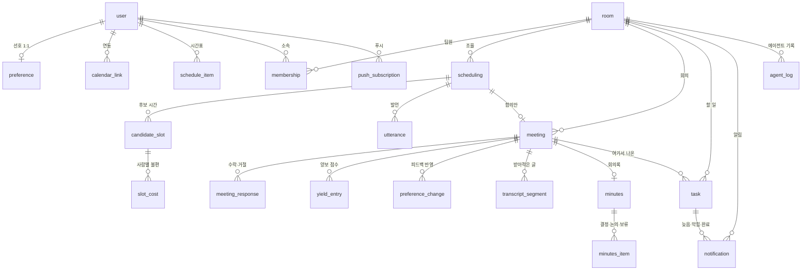

# DB 설계 · ERD

- 작성일: 2026-11-03 · 고친 날: 2026-11-03 (PostgreSQL로, 그다음 새 API 명세에 맞춰)
- 기준 문서: **API 명세(11/3판, 레인 A/B 표)**, `디자인-브리프.md`(11/3판), 아키텍처 문서(C안)
- 테이블 22개. 레인 A가 13개, B가 8개, 공통 1개입니다.
- 명세와 브리프가 어긋나는 여섯 곳은 §9에 모아 뒀습니다. 그중 셋은 스키마가 걸려 있습니다.

---

## 0. 전제

- **PostgreSQL + SQLModel.** 드라이버는 `psycopg[binary]`, 접속은 `DATABASE_URL` 하나로만 받습니다(코드에 박지 않기).
- **마이그레이션 도구를 쓰지 않습니다.** Alembic은 13일짜리에 과합니다. 스키마가 바뀌면 `python -m tools.reset_db` 하나로 **스키마를 통째로 지우고** 다시 만들고 시드를 넣습니다. 시연 데이터는 전부 시드에서 나오므로 지워도 잃을 게 없습니다.
  - `drop_all`이 아니라 `DROP SCHEMA public CASCADE`인 이유: `drop_all`은 **지금 모델에 있는 테이블만** 지웁니다. 그래서 모델에서 테이블을 빼면(11/3의 `scheduling_note`) 그게 DB에 남아 FK로 다른 테이블을 붙잡고 `DROP TABLE`이 실패합니다. 마이그레이션을 안 쓰기로 한 선택이 성립하려면 이 길이 항상 열려 있어야 합니다.
  - 다만 **배포 DB에 사람이 넣은 데이터가 생긴 뒤부터는 이 방법을 쓸 수 없습니다** — 그때부터는 손으로 `ALTER TABLE`을 씁니다.
- **열거값은 Postgres ENUM 타입으로 만들지 않습니다.** `text` + 파이썬 `StrEnum`에 `CHECK`를 거는 쪽입니다. 네이티브 ENUM은 값 하나 더할 때마다 `ALTER TYPE`이 필요한데 기획이 아직 움직입니다. 아래 표의 `enum`은 전부 이 뜻입니다.
- **시각은 `TIMESTAMPTZ`에 KST aware로 넣습니다.** API 명세의 권장 규칙 2가 "시각에 오프셋(`+09:00`)을 붙임"이고, 안 지키면 "시연 시계를 옮겼을 때 늦음 판정과 30분 전 알림이 어긋난다"고 못박았습니다. aware `datetime`을 넣으면 FastAPI가 알아서 `+09:00`을 붙여 내보내므로 규칙을 잊을 길이 없습니다. naive로 저장하고 응답에서 손으로 오프셋을 붙이면 한 군데만 빠뜨려도 그 사고가 납니다.
- **그래서 naive `datetime`을 만들지 않습니다.** `shared/demo_clock.py`가 항상 aware를 돌려줍니다. 섞이면 비교에서 `TypeError`가 나므로 일찍 터지고, 조용히 틀리지는 않습니다.
- **"지금"은 항상 `shared/demo_clock.py`에서 읽습니다.** 시연 시계를 `PUT /demo/clock`으로 옮기므로 `datetime.now()`도 SQL의 `NOW()`도 직접 쓰지 않습니다.
- **PK는 `int`로 두고 응답에서 문자열로 바꿉니다.** 명세의 "ID는 문자열, 프론트는 안을 들여다보지 않음"은 응답 모양에 대한 약속입니다. DB를 UUID로 바꿀 이유는 아니고, 작은 정수가 시드·`psql`·로그에서 훨씬 편합니다.
- **API 베이스는 `/api/v1`, 키는 `snake_case`.** 열 이름을 그대로 내보낼 수 있게 모델도 `snake_case`로 맞춥니다.
- **인증은 세션 쿠키입니다.** 서명 쿠키를 쓰면 테이블이 필요 없습니다. 다만 아래 "확인이 필요한 것"에 걸리는 문제가 하나 있습니다.
- **회의는 30분 단위.** `start_at`의 분은 0 또는 30입니다. 길이도 30의 배수입니다 — `CHECK (duration_min % 30 = 0)`.
- **하루 안의 시각은 분으로 셉니다.** 자정부터 분 (`13:00` → `780`). 에브리타임이 5분 단위로 주므로 `starttime * 5`로 바로 들어옵니다.
- **요일은 0=월 … 6=일.** 에브리타임과 같습니다.
- **접속처는 아직 안 정했습니다.** 로컬 Docker인지 매니지드(Neon·Supabase)인지만 고르면 됩니다. 코드는 `DATABASE_URL`만 보므로 나중에 바꿔도 됩니다.

### Postgres라서 할 일

SQLite로 짰다면 공짜였던 것 하나를 잃고, 새로 쓸 수 있는 것 몇 개가 생깁니다.

**1) 전원 수락은 행을 잠그고 해야 합니다 `[필수]`**

SQLite는 쓰기 하나당 DB 전체가 잠겨서 이 문제가 아예 없었습니다. Postgres는 동시에 들어갑니다. 마지막 두 사람이 거의 같은 순간에 수락을 누르면 둘 중 하나가 일어납니다.

- 둘 다 "아직 전원이 아니네"로 읽고 **아무도 확정하지 않습니다.** 확정 버튼이 없으므로 회의가 영원히 `proposed`로 남습니다.
- 둘 다 전원으로 읽고 `yield_entry`와 알림이 **두 번** 생깁니다. 양보 점수가 두 배로 들어갑니다.

시연이 노트북 한 대에 두 화면을 띄우는 구조라 실제로 일어납니다. 응답을 처리하는 트랜잭션 맨 앞에서 회의 행을 잠급니다.

```sql
SELECT * FROM meeting WHERE id = :id FOR UPDATE;
```

SQLModel이면 `select(Meeting).where(Meeting.id == id).with_for_update()` 한 줄입니다. 빼면 시연 당일에 터지는데, 두 번에 한 번만 터져서 원인을 찾기 어렵습니다.

**2) 제약으로 막을 것 `[권장]`**

| 어디 | 제약 |
|---|---|
| `scheduling` | `UNIQUE (room_id) WHERE status = 'running'` (부분 인덱스) — **한 방에 도는 조율은 하나만** |
| `slot_cost` | `CHECK (score BETWEEN 1 AND 5)` |
| `yield_entry` | `CHECK (points IN (1, 2))` |
| `candidate_slot`, `meeting` | `CHECK (start_at < end_at)` |
| `schedule_item` | `CHECK (weekday BETWEEN 0 AND 6)` |
| FK | 기본은 `ON DELETE CASCADE` — 방을 지우면 딸린 게 같이 지워지게. 출처·담당자처럼 지워져도 행이 남아야 하는 곳만 `SET NULL` (`meeting.scheduling_id` `meeting.candidate_slot_id` `preference_change.meeting_id` `task.meeting_id` `task.assignee_user_id` `task.confirmed_by` `transcript_segment.speaker_user_id`) |

부분 인덱스가 제일 값어치 있습니다. 조율이 도는 중에 팀장이 한 번 더 누르는 일은 쉽게 일어나고, 그러면 발언이 두 줄기로 섞여 핵심 화면이 망가집니다.

**3) 배열을 씁니다**

`preference.dayparts`는 `text[]`입니다. 콤마로 이은 문자열을 파싱하지 않습니다.

**4) 쓸 수 있지만 안 쓰는 것**

- **LISTEN/NOTIFY.** 명세의 `GET /rooms/{id}/events`가 SSE로 바뀌었지만, 서버가 그 SSE를 채우는 방법은 DB를 짧은 간격으로 들여다보는 쪽으로 둡니다. 팀 넷이 쓰는 방 하나에 LISTEN/NOTIFY를 붙일 이유가 없고, 연결 하나가 DB 연결 하나를 잡아먹습니다.
- **제외 제약(`EXCLUDE USING gist`)으로 시간 겹침 막기.** `btree_gist`를 켜고 범위 타입을 익혀야 하는데, 겹침은 빈칸 찾기가 어차피 파이썬에서 계산합니다. 2주짜리에 넣을 것이 아닙니다.

### 두 가지 이름, 한 행

같은 것이 상태만 바뀌는데 테이블을 둘로 쪼개지 않습니다. API 경로가 둘이어도 읽는 행은 하나입니다.

| API | 실제로 읽는 것 |
|---|---|
| `GET /proposals/{id}` | `meeting` 중 `status='proposed'`인 행 |
| `GET /meetings/{id}` | 같은 `meeting` 행 (`status='confirmed'` 이후) |
| `/suggestions/{id}` | `task` 중 `confirmed=false`인 행 |
| `/tasks/{id}` | 같은 `task` 행 (`confirmed=true` 이후) |

덕분에 전원 수락으로 확정될 때 행을 옮기지 않고 `status`만 바꿉니다. 일정 화면이 "조율 중인 회의도 자리를 잡아 둔다"를 그냥 `meeting` 전체 조회로 그릴 수 있습니다.

**이 두 쌍이 각각 레인을 넘습니다.** `/proposals/*`는 A(Meeting)이고 `/meetings/*`는 B(Record)인데 같은 `meeting` 행을 봅니다. `/suggestions/*`와 `/tasks/*`는 둘 다 B라 문제없습니다. 그래서 `meeting`은 **A가 `proposed`→`confirmed`까지 쓰고, 그 뒤 기록·요약 칸은 B가 씁니다.** 같은 행의 다른 칸을 나눠 쓰는 것이니 서로 남의 칸을 건드리지 않으면 됩니다.

### 담당

API 명세의 레인 표를 그대로 따릅니다. **도메인이 테이블을 결정합니다** — 그 도메인의 엔드포인트를 만드는 사람이 그 테이블을 만들고 씁니다.

| 레인 | 도메인 | 테이블 |
|---|---|---|
| **A** (이진희) | Onboard | `preference` |
| | MyPage 시간표·프로필 | `schedule_item` |
| | Meeting | `scheduling`, `candidate_slot`, `slot_cost`, `utterance`, `meeting`, `meeting_response`, `yield_entry`, `preference_change` |
| | Notice | `notification`, `agent_log`, `push_subscription` |
| | Home | (읽기만. 자기 테이블 없음) |
| **B** (장연우) | Room | `user`, `room`, `membership` |
| | MyPage 외부 연동 | `calendar_link` |
| | Record | `transcript_segment`, `minutes`, `minutes_item` |
| | Suggest · Task | `task` |
| **공통** | Demo | `demo_state` |

A가 13개, B가 8개, 공통 1개로 **22개**입니다.

**접점은 세 곳입니다.**

| 접점 | 누가 만들고 | 누가 읽고 |
|---|---|---|
| `user`·`room`·`membership` | B | A가 거의 모든 쿼리에서 읽습니다. **A의 FK가 전부 여기로 걸리므로 B가 제일 먼저 만들어야 합니다** |
| `meeting` | A가 `status='confirmed'`까지 | B가 그 `id`에 기록·회의록·할 일을 붙입니다 |
| `notification` | A | **B의 할 일 사건(늦음·막힘·완료)으로도 행이 생겨야 합니다** |

마지막 줄이 "서로의 테이블에 쓰지 않는다"와 부딪칩니다. 해결은 **A가 함수 하나만 내놓는 것**입니다 — `notice/alerts.py`의 `emit(kind, user_id, ...)`. B는 할 일 상태를 바꿀 때 그 함수를 부르고, `notification` 테이블에는 직접 쓰지 않습니다. 명세가 "카드는 B가 만듦"이라고 적은 것이 이 뜻입니다.

---

## 1. ERD



`demo_state`는 아무것과도 안 엮이는 한 행짜리 테이블이라 그림에 넣지 않았습니다(§5.5).

아래 표에서 **`datetime`은 전부 `TIMESTAMPTZ`** 이고, `str?`처럼 `?`가 붙은 것은 nullable입니다.

---

## 2. Room — B 담당, A가 먼저 만들어 넘김

> **장연우님께.** 레인 표대로면 이 세 테이블은 Room 도메인이라 B 것입니다. 그런데 **A의 테이블 13개가 전부 이 셋으로 FK가 걸려서**, 이게 없으면 A 쪽 `create_all`이 아예 돌지 않습니다. 오늘(D1) A가 막히지 않으려고 **제가 먼저 만들어 뒀습니다.**
>
> `app/shared/models.py`에 있습니다. **이 파일은 이제 B 것으로 넘깁니다** — 열을 더하거나 고치실 때 저에게 안 물어보셔도 됩니다. 아래에 왜 이렇게 생겼는지 적어 뒀으니, 마음에 안 드는 곳은 고치고 이 문서에 반영만 해 주세요. 다만 **A가 읽는 세 가지는 미리 말해 주셔야 합니다**: `user.id`, `room.leader_user_id`(조율 시작이 팀장만이라 권한을 여기서 봅니다), `membership.yield_total`(조율의 양보 차등).
>
> 지금 비어 있는 것: 로그인·세션(명세대로 세션 쿠키), 초대 코드 만드는 규칙, `member_count`를 실제 인원과 맞추는 로직. 전부 Room 도메인이라 B 쪽에서 채우시면 됩니다.

### 설계 이유 (인계용)

| 왜 이 열이 있나 | 이유 |
|---|---|
| `room.due_date` | **마감 디데이의 유일한 기준.** 11/3에 단계·점검일·진행률을 다 없애서, 홈과 일정 화면의 "남은 날"이 이 한 칸에서 나옵니다 |
| `room.invite_code` | `GET /rooms/by-invite-code/{code}`가 이걸로 찾습니다. unique여야 합니다 |
| `room.leader_user_id` | **이 방에서 팀장인지 보는 유일한 자리.** 방 만들기와 조율 시작이 팀장만이고, 명세 권장 규칙 4의 `can_*`를 만들 때 이 열을 읽습니다 |
| `membership`에 `role`이 없음 | **11/3에 뺐습니다.** 한 팀에서 팀장이 바뀌지 않기로 했으니 "그때 누가 팀장이었나"를 남길 일이 없습니다. 두 곳에 두면 서로 어긋날 수 있고(`room`은 지수, `membership`은 민지), `leader_user_id`는 `NOT NULL`이라 **팀장이 정확히 한 명**임을 DB가 보장합니다 — `role` 열로는 둘이 `leader`가 되는 것을 막으려면 부분 인덱스를 또 걸어야 합니다. 팀장을 넘기거나 공동 팀장을 두기로 하면 그때 다시 생각합니다 |
| `membership.part` | 팀 화면의 "역할"(자료조사·발표·개발·디자인). 자유 입력이라 열거값으로 묶지 않았습니다 |
| `membership.yield_total` | **누적 양보 점수.** `yield_entry`를 매번 합산하지 않으려고 둔 값입니다. A가 조율할 때마다 읽으므로 합계 쿼리로 두면 조율이 느려집니다. A가 회의 확정 시 같은 트랜잭션에서 올립니다 — **B는 이 열을 쓰지 마세요** |
| `membership`이 `(room_id, user_id)` unique | 같은 사람이 한 방에 두 번 들어오는 것을 DB에서 막습니다 |
| `user`에 선호가 없음 | 선호는 방마다 다르지 않아서(온보딩은 한 번) `preference` 테이블로 뺐습니다. 그건 A 것입니다 |

`user`에 비밀번호·이메일 열이 없는 이유: 명세가 "인증은 세션 쿠키"로 정했지만 **무엇으로 로그인하는지**(학교 메일? 아이디?)는 아직 안 적혀 있습니다. 정해지면 B가 붙이시면 됩니다. 시연은 `POST /demo/switch-user`로 사람을 바꿉니다.


### `user`

| 열 | 형 | 비고 |
|---|---|---|
| id | int PK | |
| name | str | "지수" |
| created_at | datetime | |

인증은 세션 쿠키로 정해졌지만 **무엇으로 로그인하는지**는 아직입니다. 비밀번호·이메일 열은 그때 붙입니다. 시연은 `POST /demo/switch-user`로 사람을 바꿉니다.

### `room`

| 열 | 형 | 비고 |
|---|---|---|
| id | int PK | |
| name | str | 과제 제목 |
| description | str | 두세 줄 |
| start_date | date | |
| due_date | date | **마감 디데이의 기준. 단계·점검일은 없습니다** |
| eval_method | str | 발표·보고서·시연 등 (자유 입력) |
| member_count | int | 팀장이 적은 예정 인원 |
| invite_code | str unique | 6자 |
| leader_user_id | int FK user | 방 생성·조율 시작 권한 |
| created_at | datetime | |

### `membership`

| 열 | 형 | 비고 |
|---|---|---|
| id | int PK | |
| room_id | int FK room | |
| user_id | int FK user | |
| part | str? | "자료조사" "발표" — 팀 화면의 역할 |
| yield_total | int | **누적 양보 점수.** `yield_entry` 합과 같게 유지 |
| joined_at | datetime | |

`(room_id, user_id)` unique.

`yield_total`은 `yield_entry`를 매번 더하지 않으려고 둔 값입니다. 팀 화면은 이걸 읽고, 누가 왜 맞춰 줬는지는 `yield_entry`를 읽습니다. 숫자 그대로는 화면에 안 나갑니다(단계로 그립니다).

---

## 3. Onboard · MyPage 시간표 · Meeting — A 담당

### `preference` — 온보딩 답 네 개

`user`와 1:1입니다. 방마다 다르지 않습니다(온보딩은 한 번).

| 열 | 형 | 비고 |
|---|---|---|
| id | int PK | |
| user_id | int FK user unique | |
| day_start_min | int? | 질문 1. 보통 가능한 시작 (`540` = 9:00) |
| day_end_min | int? | 질문 1. 끝 |
| mode_pref | enum? | 질문 2. `offline` / `online` / `any` |
| dayparts | text[] | 질문 3. 여러 개 — `{morning,afternoon}` |
| avoid_raw | str? | 질문 4. 사람이 적은 말 그대로 |
| avoid_polished | str? | 질문 4를 에이전트가 다듬은 문장. **조율 때 이유로 말하는 건 이쪽입니다** |
| updated_at | datetime | |

- **네 개 모두 비어도 됩니다.** 필수 항목이 없습니다. 비면 빈칸 찾기에서 그 조건을 안 씁니다.
- `dayparts`를 테이블로 안 뺀 이유: 값이 여섯 개로 고정이고 조건 검색을 안 합니다. Postgres 배열 한 칸으로 끝납니다. SQLModel에서는 `sa_column=Column(ARRAY(String))`입니다.
- `avoid_polished`는 온보딩 직후 한 번 LLM으로 만들어 저장합니다. 조율마다 다시 부르지 않습니다.

### `calendar_link` — 연동 상태 `[B 담당]`

레인 표에서 "MyPage 중 외부 연동"이 B라서 이 테이블만 B 것입니다. A는 읽지 않습니다 — A가 쓰는 것은 연동 결과인 `schedule_item`뿐입니다. 내 조건 화면의 "마지막 동기화 시각"은 B의 응답에서 받아 붙입니다.

| 열 | 형 | 비고 |
|---|---|---|
| id | int PK | |
| user_id | int FK user | |
| kind | enum | `everytime` / `google` |
| external_ref | str | 에브리타임 아이디, 또는 구글 계정 |
| access_token | str? | 구글만 |
| refresh_token | str? | 구글만 |
| status | enum | `ok` / `failed` |
| last_synced_at | datetime? | 내 조건 화면이 보여 줍니다 |

`(user_id, kind)` unique. 에브리타임은 `everytime.kr/@아이디` 링크에서 아이디만 떼어 넣습니다.

### `schedule_item` — 시간표 한 칸

수업·알바·약속이 다 여기 들어옵니다. **확정된 회의는 넣지 않습니다** — `meeting`에서 읽어 겹칩니다. 같은 걸 두 곳에 쓰면 반드시 어긋납니다.

| 열 | 형 | 비고 |
|---|---|---|
| id | int PK | |
| user_id | int FK user | |
| group_id | int? | 같은 값을 가진 행들이 "묶인 일정" 하나 |
| source | enum | `everytime` / `google` / `manual` |
| kind | enum | `class` / `parttime` / `appointment` |
| title | str? | **`appointment`는 비웁니다.** 화면에 "바쁨"으로만 나갑니다 |
| recurrence | enum | `weekly` / `once` |
| weekday | int? | `weekly`일 때 0=월 … 6=일 |
| start_min | int? | `weekly`일 때 자정부터 분 |
| end_min | int? | |
| start_at | datetime? | `once`일 때 |
| end_at | datetime? | |
| valid_from | date? | `weekly`의 학기 범위 |
| valid_to | date? | |
| created_at | datetime | |

- **묶음은 행 하나가 아니라 `group_id`가 같은 여러 행입니다.** 명세의 `PUT /me/schedule/groups/{id}`가 "요일마다 다른 시간"이라고 적었습니다. 월 9시·수 11시인 수업 하나는 요일별 시간이 다르므로 한 행에 담을 수 없습니다. `POST /me/schedule/items`의 "요일 여러 개를 한 번에"도 같은 얘기 — 한 번 호출에 `group_id` 하나로 여러 행이 들어갑니다.
- 묶음 테이블은 따로 두지 않습니다. 묶음에 제목·종류 말고 자기 속성이 없고, 그건 각 행에 이미 있습니다.
- 에브리타임 수업은 `weekly` + `class`, 구글 약속은 `once` + `appointment`, 알바는 사람이 넣는 `weekly` + `parttime`입니다.

### `scheduling` — 조율 한 번

| 열 | 형 | 비고 |
|---|---|---|
| id | int PK | |
| room_id | int FK room | |
| started_by | int FK user | 팀장 |
| topic | str | 주제 |
| window_start | datetime | 언제부터 |
| window_end | datetime | 언제 사이에 |
| duration_min | int | 30의 배수 |
| mode | enum | `offline` / `online` / `any` |
| status | enum | `running` / `agreed` / `needs_pick` / `no_common` / `failed` |
| rounds_used | int | 0~3 |
| created_at | datetime | |
| closed_at | datetime? | |

`status`가 화면 세 갈래와 1:1입니다. `agreed` → 회의 일정 조율 확인 화면, `needs_pick` → 후보 2~3개 고르기, `no_common` → 1명 불참안.

### `candidate_slot` — 후보 시간

채점기가 만든 후보가 다 남습니다. 제안한 것도, 거절당한 것도, 못 고른 것도 남깁니다. 시연에서 "왜 이 시간이죠"에 답할 근거입니다.

| 열 | 형 | 비고 |
|---|---|---|
| id | int PK | |
| scheduling_id | int FK scheduling | |
| start_at | datetime | 분은 0 또는 30 |
| end_at | datetime | |
| total_cost | float | 팀 전체 불편 합 |
| round_no | int | 몇 라운드에 나왔나 |
| proposed | bool | 판단 에이전트가 실제로 제안했나 |
| absentee_user_id | int? | 1명 불참안이면 빠지는 사람 |
| created_at | datetime | |

### `slot_cost` — 사람별 불편

| 열 | 형 | 비고 |
|---|---|---|
| id | int PK | |
| candidate_slot_id | int FK candidate_slot | |
| user_id | int FK user | |
| score | int | **1~5.** 1=괜찮음 |
| available | bool | false면 그 시간에 아예 안 됨 |
| reason | str | 에이전트가 말할 이유 한 줄 |

`(candidate_slot_id, user_id)` unique.

- **본인에게만 숫자로 보입니다.** 남의 `score`는 괜찮음/조금/많이로 바꿔 내보냅니다. 서버가 지킵니다(`api-스펙.md` 권장 규칙 3).
- `score`는 계산이 정합니다. 에이전트가 정하지 않습니다 — 그래서 리허설과 본 시연이 같은 답을 냅니다.
- `reason`은 겹치는 `schedule_item`과 `preference.avoid_polished`에서 만듭니다.

### `utterance` — 발언

"시간 정하는 과정" 화면이 하나씩 꺼내 보여 주는 줄들입니다.

| 열 | 형 | 비고 |
|---|---|---|
| id | int PK | |
| scheduling_id | int FK scheduling | |
| round_no | int | 1~3 |
| seq | int | 화면에 나올 순서 |
| speaker_kind | enum | `judge` / `member` |
| speaker_user_id | int? | `member`일 때만 |
| text | str | |
| created_at | datetime | |

`(scheduling_id, seq)` unique. SSE가 `seq` 다음 것부터 흘려보냅니다. 새로 들어와도 처음부터 다시 볼 수 있습니다.

### `meeting` — 회의 (= 합의안)

| 열 | 형 | 비고 |
|---|---|---|
| id | int PK | |
| room_id | int FK room | |
| scheduling_id | int? FK scheduling | 조율 없이 만든 회의면 비움 |
| candidate_slot_id | int? FK candidate_slot | 고른 후보 |
| topic | str | |
| start_at | datetime | |
| end_at | datetime | |
| mode | enum | `offline` / `online` |
| status | enum | `proposed` / `confirmed` / `done` / `cancelled` |
| rationale | str | **판단 에이전트가 쓴 1~3문장.** 왜 이 시간인지 |
| confirmed_at | datetime? | 전원 수락한 순간 |
| transcript_mode | enum? | `stt` / `manual` — 회의록 쪽이 씀 |
| recording_started_at | datetime? | 회의록 쪽이 씀 |
| recording_stopped_at | datetime? | 회의록 쪽이 씀 |
| created_at | datetime | |

아키텍처 문서의 두 사람 계약 `Meeting { id, slot, attendees, why }`가 이 행입니다. `slot` = `start_at`/`end_at`, `attendees` = `meeting_response`, `why` = `rationale`.

뒤쪽 세 열은 회의록 쪽이 쓰는 칸입니다. 회의 잡기는 읽지도 쓰지도 않습니다.

### `meeting_response` — 수락·거절

| 열 | 형 | 비고 |
|---|---|---|
| id | int PK | |
| meeting_id | int FK meeting | |
| user_id | int FK user | |
| state | enum | `pending` / `accepted` / `declined` |
| feedback | str? | 확인 창에 남긴 한 줄. 비어도 됩니다 |
| responded_at | datetime? | |

`(meeting_id, user_id)` unique. 합의안이 만들어질 때 팀원 수만큼 `pending`으로 미리 깔아 둡니다 — 그래야 "누가 아직 안 답했는지"를 이름으로 보여 줄 수 있습니다.

**전원 `accepted`가 되는 그 요청 안에서** `meeting.status='confirmed'`, `confirmed_at`, `yield_entry`, 알림까지 한 트랜잭션으로 처리합니다. 확정 버튼이 없으므로 다른 기회가 없습니다.

**그 트랜잭션은 `meeting` 행을 `FOR UPDATE`로 잠그고 시작합니다.** 안 잠그면 마지막 두 사람이 같은 순간에 누를 때 아무도 확정하지 않거나 양보 점수가 두 번 들어갑니다(§0 참고).

### `yield_entry` — 양보 장부

| 열 | 형 | 비고 |
|---|---|---|
| id | int PK | |
| room_id | int FK room | |
| meeting_id | int FK meeting | |
| user_id | int FK user | 점수를 받는 사람 |
| points | int | **+1 또는 +2** |
| discomfort | int | 근거가 된 불편 점수 2~5 (1점은 행을 만들지 않음) |
| reason | str | "내 불편 3/5만큼 맞춰 줘서 +1" |
| created_at | datetime | |

차등은 불편 점수에서 나옵니다. 2~3점 → +1, 4~5점 → +2, 1점 → 행을 만들지 않습니다.

확정될 때 한 번만 만듭니다. `membership.yield_total`도 같은 트랜잭션에서 올립니다.

### `preference_change` — 피드백이 바꾼 것

| 열 | 형 | 비고 |
|---|---|---|
| id | int PK | |
| user_id | int FK user | |
| meeting_id | int? FK meeting | 어느 응답에서 나왔나 |
| source_text | str | 사람이 적은 한 줄 |
| field | str | 바뀐 `preference` 열 이름 |
| before | str? | |
| after | str? | |
| summary | str | "다음부터 11시 이전은 피할게요" |
| reverted | bool | 되돌리기를 눌렀나 |
| created_at | datetime | |

- **말없이 바꾸면 안 됩니다.** 이 행이 곧 화면에 보이는 "무엇이 어떻게 바뀌었는지 한 줄"입니다. 행을 안 만들고 `preference`만 고치는 길은 없습니다.
- 아무것도 안 바뀌면 행을 만들지 않습니다. 억지로 바꾸지 않습니다.
- 되돌리기는 `before`를 `preference`에 다시 쓰고 `reverted=true`로 둡니다. 행을 지우지 않습니다.

---

## 4. Record — B 담당

### `transcript_segment`

| 열 | 형 | 비고 |
|---|---|---|
| id | int PK | |
| meeting_id | int FK meeting | |
| seq | int | |
| speaker_label | str? | **미정(화자 구분 방식 합의 전).** STT가 붙이는 익명 라벨 `"A"` `"B"`. 제안일 뿐이고 비어 있어도 됩니다 |
| speaker_user_id | int? | 사람이 라벨을 이름에 매핑하거나 줄마다 직접 고릅니다. 비어 있어도 됩니다 |
| text | str | |
| created_at | datetime | |

음성은 저장하지 않습니다. 글자만 남습니다.

### `minutes`

| 열 | 형 | 비고 |
|---|---|---|
| id | int PK | |
| meeting_id | int FK meeting unique | |
| headline | str | **주제 한 줄.** 날짜별 목록에도 이게 보입니다 |
| status | enum | `summarizing` / `done` / `failed` |
| created_at | datetime | |

### `minutes_item`

| 열 | 형 | 비고 |
|---|---|---|
| id | int PK | |
| minutes_id | int FK minutes | |
| kind | enum | `decision` / `discussion` / `pending` |
| seq | int | |
| text | str | |

원문의 해당 발화로 점프하지 않으므로 `transcript_segment`를 가리키는 열이 없습니다.

---

## 5. Task · Notice — 레인이 갈립니다

`task`는 B, 알림 셋은 A입니다.

### `task` `[B 담당]`

| 열 | 형 | 비고 |
|---|---|---|
| id | int PK | |
| room_id | int FK room | |
| meeting_id | int? FK meeting | 출처. 직접 추가면 비움 |
| title | str | |
| due_date | date? | |
| assignee_user_id | int? | **비어 있는 게 정상입니다** |
| state | enum | `todo` / `doing` / `blocked` / `done` |
| origin | enum | `ai` / `manual` — "AI 제안" 표시 |
| confirmed | bool | false면 회의록에서만 보이는 제안 |
| confirmed_by | int? FK user | 누가 확정했나 |
| confirmed_at | datetime? | |
| dropped | bool | "필요 없음"으로 뺀 것 |
| created_at | datetime | |

진행률 숫자, 예상 소요 시간, 재분배 제안은 열이 없습니다. `state` 네 개로 끝입니다.

### `notification` `[A 담당]`

A가 만들고 A만 씁니다. B는 할 일 사건이 났을 때 A가 내놓은 `notice/alerts.py`의 `emit()`을 부릅니다 — 이 테이블에 직접 쓰지 않습니다.

| 열 | 형 | 비고 |
|---|---|---|
| id | int PK | |
| room_id | int FK room | |
| user_id | int FK user | 받는 사람 |
| kind | enum | `late` / `blocked` / `done` / `meeting_soon` / `meeting_proposed` / `meeting_confirmed` |
| task_id | int? FK task | |
| meeting_id | int? FK meeting | |
| reason | str | 이유 한 줄 |
| dedupe_key | str | |
| read_at | datetime? | |
| created_at | datetime | |

`(user_id, dedupe_key)` unique. `dedupe_key`에 상황을 녹여 넣습니다(예: `late:task42:due20261120`). 상황이 바뀌어야 새 행이 생기므로 알림함이 같은 카드로 차지 않습니다.

### `agent_log` `[A 담당]`

| 열 | 형 | 비고 |
|---|---|---|
| id | int PK | |
| room_id | int FK room | |
| user_id | int? FK user | |
| what | str | 무엇을 |
| why | str | 왜 |
| created_at | datetime | |

### `push_subscription` `[A 담당]`

| 열 | 형 | 비고 |
|---|---|---|
| id | int PK | |
| user_id | int FK user | |
| endpoint | str unique | |
| p256dh | str | |
| auth | str | |
| created_at | datetime | |

---

## 5.5 공통 — Demo

### `demo_state` — 시연 시계

행이 **하나만** 있는 테이블입니다.

| 열 | 형 | 비고 |
|---|---|---|
| id | int PK | 항상 1 — `CHECK (id = 1)` |
| now_at | timestamptz? | 비어 있으면 실제 시각을 씁니다 |
| updated_at | timestamptz | |

명세에 `GET/PUT/DELETE /demo/clock`이 있어서 **시연 시계를 환경변수로 둘 수 없습니다.** `PUT`으로 옮긴 값이 다음 요청에도 남아야 하고, 워커가 둘 이상이면 프로세스 메모리로도 안 됩니다. 한 행짜리 테이블이 제일 싼 공유 저장소입니다.

`shared/demo_clock.py`의 `now()`가 이 행을 읽습니다. `now_at`이 비어 있으면 실제 시각(`DELETE /demo/clock`이 이 상태로 돌립니다).

---

## 6. 조율 한 번이 DB에 남기는 것

구현 순서가 그대로 이 순서입니다.

1. 팀장이 회의 잡기에서 조율 시작 → `scheduling` 한 행 (`status='running'`)
2. **빈칸 찾기.** `schedule_item`(weekly는 `window_start`~`window_end`로 펼쳐서) + `confirmed`인 `meeting`을 모아 겹치지 않는 30분 격자를 만듭니다. `preference.day_start_min`/`day_end_min` 밖은 버립니다.
3. **채점.** 남은 후보마다 `candidate_slot` + 사람 수만큼 `slot_cost`. 여기까지 LLM이 안 들어옵니다.
4. **라운드 1~3.** `total_cost`가 낮은 후보를 제안(`proposed=true`) → 판단 에이전트와 팀원 에이전트 발언이 `utterance`로 쌓입니다. 거절이 나오면 `yield_total`을 보고 다음 후보를 고릅니다.
5. 합의 → `scheduling.status='agreed'`, `meeting` 한 행 (`status='proposed'`, `rationale` 채움), 팀원 수만큼 `meeting_response`(`pending`)
   - 3라운드 실패 → `needs_pick`. 후보는 이미 `candidate_slot`에 있으니 `proposed=true`인 것 2~3개를 보여 주고 고르게 합니다.
   - 전원 가능한 시간 없음 → `no_common`. `absentee_user_id`가 찬 후보를 냅니다.
6. 수락·거절 → `meeting_response` 갱신, `feedback`이 비지 않으면 `preference_change` 판정
7. **마지막 사람이 수락한 그 요청 안에서** → `meeting.status='confirmed'` + `confirmed_at` + `yield_entry` + `membership.yield_total` + `notification`(`meeting_confirmed`). 한 트랜잭션이고, **맨 앞에서 `meeting`을 `FOR UPDATE`로 잠급니다.**
8. 회의 30분 전 → `notification`(`meeting_soon`) + 웹 푸시

---

## 7. 안 만든 테이블과 이유

| 안 만든 것 | 왜 |
|---|---|
| `plan`, `phase` | 플랜 고르기와 단계를 없앴습니다. 마감 디데이 하나로 관리합니다 |
| `checkpoint` | 점검일을 받지도 보여 주지도 않습니다 |
| `consent` | 받아적기 전 참석자 동의 단계가 없어졌습니다. 브라우저 마이크 권한만 최초 1회 |
| `proposal` (별도) | `meeting` 중 `status='proposed'`인 행입니다 |
| `suggestion` (별도) | `task` 중 `confirmed=false`인 행입니다 |
| `transcript` (별도) | `meeting`에 `transcript_mode`와 녹음 시각만 붙였습니다 |
| `schedule_group` | 묶음에 자기 속성이 없습니다. `schedule_item.group_id`가 같은 행들이 묶음 하나입니다 |
| `scheduling_note` | 브리프의 참고 항목이었고 **11/3에 뺐습니다.** 조율 시작에서 팀원이 한 줄 남기는 칸이 없습니다. 조율은 시간표·선호·누적 양보 점수만으로 돌아가므로 이 칸이 없어도 로직이 그대로입니다 |
| `daypart` | 값이 여섯 개로 고정이고 조건 검색을 안 합니다. `preference.dayparts` 배열 한 칸으로 둡니다 |
| `task_progress` | 진행률 숫자를 없앴습니다. `task.state` 네 개로 충분합니다 |

---

## 8. 시드 데이터

브리프의 "시안에 쓸 예시 데이터"와 같게 맞춥니다. 시연 화면과 시안이 어긋나지 않게 하려는 것입니다.

| user | part | 시간표 | 양보 |
|---|---|---|---|
| 지수 | 자료조사 (팀장) | 수업 보통 | 0 |
| 민지 | 발표 | **수업이 많음** | 0 |
| 현우 | 개발 | **평일 저녁 알바** | **+3 (지난 회의 두 번)** |
| 서연 | 디자인 | 비대면 선호 | 0 |

시드는 스키마를 지우고 다시 만든 뒤 한 번 돌리는 스크립트 하나입니다. 스키마를 고칠 때마다 이걸 다시 돌리게 되므로, 손으로 넣은 데이터에 의존하지 않게 만듭니다.

- room: "서비스디자인 팀 프로젝트", 평가 "최종 발표 + 시연", 마감 **2026-12-11**
- 현우의 `yield_total=3`이 있어야 2라운드에서 "현우는 지난 두 번의 회의에서 많이 맞춰 줬어요"가 나옵니다. **시드에 이게 없으면 시연의 핵심 대사가 안 나옵니다.**
- 지난 회의 한 건을 `status='done'`으로, 회의록과 보류 항목까지 넣어 둡니다. 30분 전 알림의 "이번에 다룰 것"이 그걸 읽습니다.

---

## 9. 명세와 어긋나 확인이 필요한 것

API 명세(11/3판)와 디자인 브리프(11/3판)를 맞춰 보다 나온 것들입니다. 셋은 스키마가 걸려 있고, 둘은 아닙니다.

### 1) 세션 쿠키로는 한 브라우저에 두 사람을 띄울 수 없습니다 `[스키마 영향 없음 · 시연 막힘]`

명세: "인증은 세션 쿠키로 갑니다. 다만 시연에서 **한 브라우저에 폰 화면 2개를 서로 다른 팀원으로** 띄워야 하므로, 사용자 바꾸기가 가벼워야 합니다."

**이 둘은 같이 안 됩니다.** 쿠키 저장소는 브라우저 프로필당 하나라서, 한 창에서 지수로 로그인하면 옆 창도 지수가 됩니다. `POST /demo/switch-user`는 **바꾸는** 것이지 둘을 **동시에 두는** 것이 아닙니다. 브리프의 "한쪽에서 수락하면 다른 쪽에 바로 반영"이 안 보입니다.

고르는 수밖에 없습니다.

| 길 | 대가 |
|---|---|
| 창 하나는 시크릿 창으로 | 공짜. 시연 때 창 두 개를 나란히 놓는 손이 조금 번거롭습니다 |
| 데모에서만 쿠키 대신 헤더·쿼리로 사용자 지정 | 서버에 데모용 길이 하나 생깁니다. 대신 한 창에 두 iframe으로 깔끔하게 띄울 수 있습니다 |

### 2) 화자 구분이 브리프와 반대입니다 `[스키마 영향 · B 담당]`

명세 `PUT .../speaker-mapping`: "**목소리 A~D → 사람.** 한 번에 전체 반영"

브리프 회의 기록: "말한 사람은 받아적는 사람이 고릅니다(**자동 화자 구분 없음**)"

명세대로면 STT가 목소리를 갈라 준다는 뜻이고, `transcript_segment`에 `speaker_label`(`"A"`) 열이 하나 더 필요합니다. 브리프대로면 `speaker_user_id`만으로 끝입니다. **자동 화자 구분은 STT 서비스를 고르는 문제라 공짜가 아닙니다.** B 담당이니 그쪽과 정해야 합니다.

### 3) 받아적기 동의가 다시 생겼습니다 `[스키마 영향 · B 담당]`

명세 `POST .../recording/start` 비고: "동의 고려 필요성"

브리프 11/3 표: "**참석자 동의 없앰.** 받아적기 전에 동의를 받지 않습니다. 브라우저 마이크 권한만 최초 1회"

동의를 다시 받으면 `meeting_consent` 테이블이 하나 생깁니다. 11/3에 일부러 뺀 것이라 되살리는 결정이 필요합니다.

### 4) 자동 완료·자동 "필요 없음" 판정이 명세에만 있습니다 `[스키마 영향 · B 담당]`

명세: `POST /rooms/{id}/auto-completed/{id}/undo`("진행 중으로"), `POST /rooms/{id}/unneeded/{id}/keep`("그대로 둠")

되돌릴 것이 있다는 건 **시스템이 스스로 완료·필요 없음으로 바꾼다**는 뜻입니다. 브리프의 알림 3종(늦음·막힘·완료)에 그런 판정이 없고, "완료"는 사람이 바꾼 것을 알리는 카드입니다. 자동 판정을 둘 거면 `task`에 `auto_completed_at`·`auto_unneeded_at` 같은 열이 붙습니다.

### 5) `rerun` 권한이 미정입니다 `[스키마 영향 없음 · 내 담당]`

명세가 "권한 미정 — 팀원도 되는지"라고 적어 뒀습니다. `widen`은 "새 `scheduling_id`를 받음"이라고 적혔는데 `rerun`은 안 적혔습니다. **같은 `scheduling`의 라운드를 이어서 도는지, 새 `scheduling`을 만드는지**를 정해야 `rounds_used`를 어떻게 셀지 정해집니다. 새로 만드는 쪽이 발언 기록이 안 섞여서 낫다고 봅니다.

### 6) `user`·`room`·`membership`을 B가 만듭니다 `[오늘 막힘]`

레인 표대로면 Room 도메인이 B 것이라 이 세 테이블은 B가 만듭니다. 그런데 **A의 FK가 전부 거기로 걸립니다** — `preference.user_id`부터 `yield_entry.room_id`까지 전부입니다. B의 테이블이 없으면 A의 `create_all`이 돌지 않습니다.

오늘(D1) 둘 중 하나를 정해야 합니다: B가 먼저 만들어 올리기를 기다리거나, A가 세 개를 먼저 만들고 B가 그 파일을 넘겨받거나.
