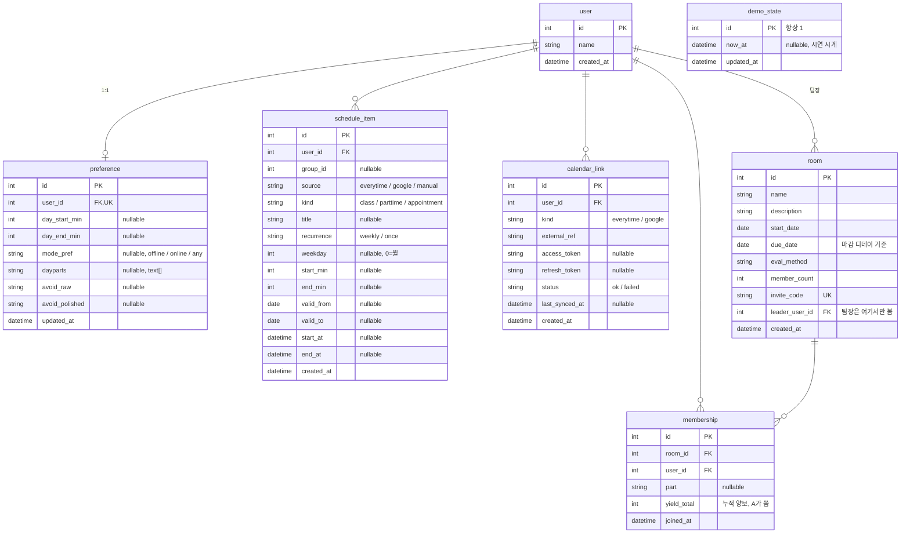
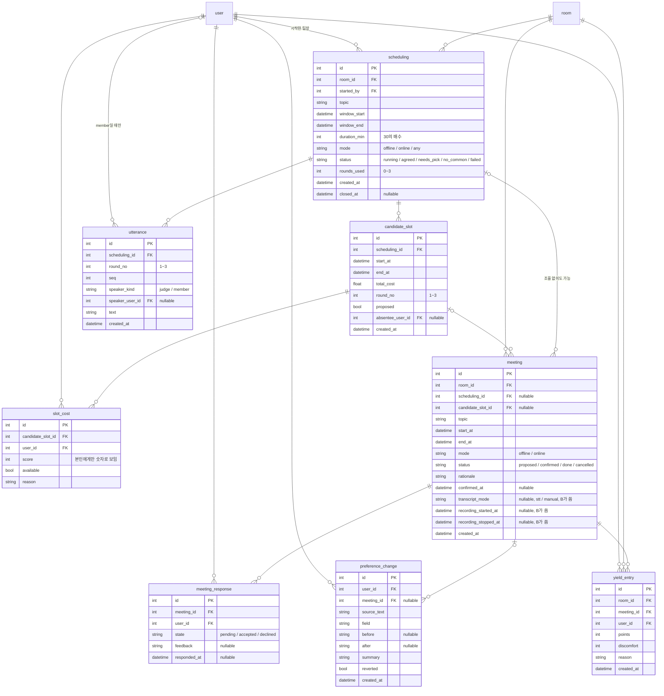
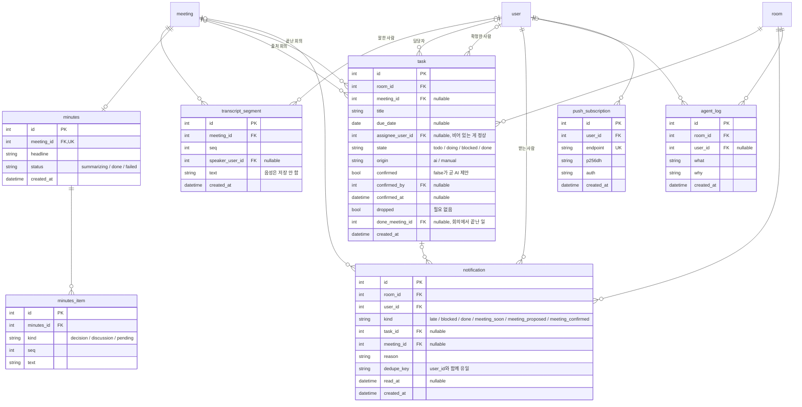

# DB 스키마 ERD

- 기준: 코드 `backend/app/*/models.py` (2026-11-04). 다르면 코드가 맞습니다.
- 22개 테이블을 도메인별 3장으로 나눠 그렸습니다. 다른 장의 테이블은 연결선에만 나옵니다.
- 설계 이유와 조율 흐름은 [backend/db-설계.md](../backend/db-설계.md).
- 점수 범위처럼 아직 안 정해진 값과 팀 합의 전인 항목은 뺐습니다.
- 표기: `nullable`은 비어도 되는 열, 따옴표 안은 열거값이나 메모입니다. `datetime`은 전부 `TIMESTAMPTZ`(+09:00).

## 1. Room · 온보딩 · 시간표 · 연동 · 시연

- `membership (room_id, user_id)` 유일, `calendar_link (user_id, kind)` 유일.
- `demo_state`는 한 행만 있는 테이블이라 연결선이 없습니다.

## 2. 조율 · 회의

- 유일: `slot_cost (candidate_slot_id, user_id)` · `utterance (scheduling_id, seq)` · `meeting_response (meeting_id, user_id)` · `yield_entry (meeting_id, user_id)`.
- `scheduling`은 한 방에 `status='running'`이 하나만 있을 수 있습니다 (부분 유일 인덱스).
- `proposed` 상태의 `meeting`이 곧 "회의안"입니다. 별도 테이블은 없습니다.

## 3. 회의록 · 할 일 · 알림

- 유일: `transcript_segment (meeting_id, seq)`.
- `task`는 `confirmed=false`인 행이 회의록의 "AI 제안"입니다. 확정 전에는 할 일 목록에 넣지 않습니다.
- `notification`은 레인 B가 직접 쓰지 않고 A의 `emit()`을 부릅니다.

## 부모를 지우면

- 기본은 같이 삭제(CASCADE)입니다.
- 아래만 NULL로 비웁니다 (SET NULL).
  - `meeting.scheduling_id` · `meeting.candidate_slot_id`
  - `preference_change.meeting_id`
  - `task.meeting_id` · `task.done_meeting_id` · `task.assignee_user_id` · `task.confirmed_by`
  - `transcript_segment.speaker_user_id`
