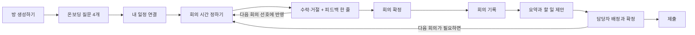

# 팀플 에이전트: 디자인 브리프 (공유용)

- 작성일: 2026-10-30 · 고친 날: 2026-11-04
- 형태: 폰 크기 웹앱
- 기준 시안: 디자인 시안 10차 (이 판의 내용은 시안 10차와 같습니다)

대학생 팀 프로젝트를 한 학기 동안 돕는 웹앱입니다. 팀원마다 붙는 AI 에이전트가 서로 양보하며 회의 시간을 잡고, 회의에서 정한 일을 할 일로 만들고, 마감까지 무엇이 막혔는지 먼저 알려 줍니다.

> **이 문서의 범위.** 각 화면에 **무엇이 들어가야 하는지**만 정합니다. 색, 글꼴, 배치, 컴포넌트 모양은 디자인 담당이 정합니다.
>
> **읽는 순서.** 화면을 쓰는 순서대로 묶었습니다. 1 → 2 → 3이 사람이 실제로 지나가는 길이고, 4는 그 위에서 계속 돌아가는 화면입니다.

---

## 11월 5일에 바뀐 것

| 무엇 | 어떻게 | 어디 |
|---|---|---|
| **사람이 고르는 단계 없앰** | 3라운드 실패·전원 가능한 시간 없음 **둘 다 판단 에이전트가 정합니다.** 팀장이 후보를 고르는 화면이 사라집니다 | 시간 정하는 과정, 회의 일정 조율 확인, 일정 |
| **라운드가 어필에서 시작** | 팀원 에이전트가 먼저 **각자 원하는 시간을 말하고** 판단 에이전트가 그중에서 고릅니다. 거절되면 다시 어필합니다 | 시간 정하는 과정 |
| **조정은 바로 확정** | 판단 에이전트가 정한 안은 수락·거절 없이 **그대로 확정**됩니다. 대신 **피드백 한 줄만** 받습니다 | 회의 일정 조율 확인 |
| **기간을 자동으로 넓히지 않음** | 전원 가능한 시간이 없으면 바로 불편·양보 점수로 판단합니다. 그래도 후보가 없을 때만 팀장에게 기간을 넓히라고 안내 | 시간 정하는 과정 |
| **피하고 싶은 시간이 점수에 들어감** | 네 번째 답을 다듬으면서 요일·시각도 뽑아, 걸리는 시간에 **불편 +2**를 줍니다. 못 뽑으면 말에만 씁니다 | 온보딩, 시간 정하는 과정 |
| **거절은 "그 시간 못 감"으로 받음** | 거절할 때 **이 시간만 / 그날 종일** 중 하나를 고르면 그 시간이 **내 시간표에 일회성 일정으로** 들어갑니다. 제목은 팀원에게 안 보이고 "바쁨"으로만 나갑니다. 그래야 다시 조율할 때 같은 시간을 또 내놓지 않습니다 | 회의 일정 조율 확인, 주간 시간표 |
| **라운드는 조율 하나에 3이 예산** | 거절 뒤 다시 조율해도 라운드를 **새로 주지 않습니다.** 1라운드에 잡힌 회의는 2라운드가 남아 있고, 3라운드를 다 쓴 회의는 다시 조율하지 않습니다 | 시간 정하는 과정 |
| **예산이 떨어지면 그 사람 빼고 진행** | 남은 라운드가 없는데 또 거절하면 회의는 **그대로 섭니다.** 그 사람은 불참으로 기록되고 "○○ 빠짐 · 회의록 요약을 따로 보내요"가 붙습니다 | 회의 일정 조율 확인, 일정 |

## 11월 4일에 바뀐 것

디자인 시안 10차를 그리면서 정한 것입니다. 이미 시안을 그렸다면 이 표부터 보고, 아래 11월 3일·2일·1일 표를 차례로 보면 됩니다.

| 바뀐 것 | 지금 | 영향받는 화면 |
|---|---|---|
| **평가 방식 없앰** | 방 생성하기에서 평가 방식(발표·보고서·시연)을 받지 않습니다. 과제 제목·설명·기간·팀원 수만 | 방 생성하기 |
| **온보딩은 모두 고르기** | 네 질문을 고르는 칸으로 받습니다(피하고 싶은 시간만 한 줄 입력). 필수가 없으니 건너뛰기 버튼과 진행 막대도 없고 "다음"만 둡니다 | 온보딩, 내 조건 |
| **거절은 이유만** | 팀원 에이전트는 거절과 이유 한 줄만 말합니다. **대안은 판단 에이전트가** 다음 라운드에서 냅니다 | 시간 정하는 과정 |
| ~~**팀장이 고름**~~ | ~~3라운드 안에 합의 실패, 전원 가능한 시간 없음 둘 다 **팀장이** 후보(또는 불참안) 하나를 고르고, 그 안에 전원이 수락·거절합니다. 팀원 화면은 "팀장 지수가 고르는 중"~~ → **11/5에 뒤집혔습니다.** 판단 에이전트가 정하고 바로 확정합니다 | 시간 정하는 과정, 회의 일정 조율 확인 |
| **급한 회의도 받아적기** | 일정 탭 맨 위에 **"지금 회의 받아적기"** 버튼을 늘 둡니다. 오늘 잡힌 회의가 있으면 거기에 붙고, 없으면 주제 한 줄(비워도 됨)만 받고 바로 시작합니다. 끝나면 지난 회의 목록에 들어갑니다 | 일정, 회의 기록 |
| **말한 사람은 끝나고 한 번 확인** | 받아적는 동안은 **목소리 A·B…** 로만 나눠 적고, 정지하면 "말한 사람 확인" 카드에서 목소리마다 누군지 한 번 고릅니다(AI가 먼저 짐작해 둠). 전에는 "받아적는 사람이 고름, 자동 구분 없음"이었습니다 | 회의 기록 |
| **회의에서 끝난 일** | 회의에서 "다 했다"고 한 할 일은 **완료로 바뀌어 회의록에 할 일 행 모양으로** 보입니다("회의에서 완료" 뱃지). 체크 박스로 끄면 진행 중으로 돌아갑니다 | 회의록, 할 일, 알림 |
| **필요 없어 보이는 일** | 회의에서 더 안 해도 된다고 한 할 일은 회의록 맨 아래에 따로 모아 **유지 / 삭제**를 고르게 합니다. 사람이 고르기 전에는 아무것도 지우지 않습니다 | 회의록 |
| **할 일 직접 추가 두 곳** | 할 일 탭 "+ 할 일 추가"(출처 "직접 추가"), 회의록 제안 목록 끝 "+ 직접 추가"(출처 그 회의, 제안을 거치지 않고 바로 확정) | 할 일, 업무 배정 검토 |
| **할 일 누름 동작** | 할 일 행은 **제목 / 기한 · 상태 칩**만. 상태 칩을 누르면 상태를 바꾸고, **길게 누르면 고치기**(제목·담당자·기한·삭제, 출처는 여기서 보임). 출처를 행에서 고치기 패널로 옮겼습니다 | 할 일, 홈 |
| **"필요 없음" → "삭제"** | 지우는 동작은 할 일·할 일 제안·내 일정 모두 **"삭제"** 하나로 씁니다. 11/2의 "필요 없음" 문구를 되돌립니다. 섹션 이름 "필요 없어 보이는 일"은 설명이라 그대로 | 전체 |
| **두 버튼 배치** | 버튼 두 개가 나란히 있으면 **왼쪽은 글자만, 오른쪽은 버튼 모양**. 삭제류는 빨강, 확정류는 기본색 | 전체 |
| **팀 할 일 필터는 상태만** | 담당자 필터를 없애고 사람별 묶음으로 대신합니다 | 팀 할 일 |
| **디데이는 홈에만** | 마감 디데이·오늘 위치·기간은 홈 맨 위 기간 카드에만 둡니다. 일정 탭은 회의 목록만 | 홈, 일정 |
| **시간표 종류 셋** | 알바·캘린더 약속·피하고 싶은 시간을 **"일정"** 하나로 묶습니다. **수업 / 일정 / 팀 회의**. 대면 가능 요일도 없앱니다 | 내 조건, 일정 연결 |
| **에이전트 말 고치기** | 내 조건으로 만든 "내 에이전트가 이렇게 말해 줘요" 문장을 본인이 직접 고칠 수 있습니다(원래대로 되돌리기 있음) | 내 조건 |
| **양보 기록 자리** | 회의별로 누가 왜 맞춰 줬는지는 **알림의 에이전트 기록 아래**로 옮깁니다. 나 탭에는 팀원별 누적 단계만 | 알림, 팀 |
| **역할 표시 없앰** | 팀원의 역할(자료조사·발표 등)을 보여 주지 않습니다. 팀장 뱃지만 | 팀, 내 조건 |
| **알림 문장 틀** | 알림 이유 한 줄은 할 일 데이터로 만듭니다(아래 알림 표) | 알림 |

## 11월 3일에 바뀐 것

| 바뀐 것 | 지금 | 영향받는 화면 |
|---|---|---|
| **플랜 고르기 없앰** | 일정 플랜 추천이 사라집니다. 방 생성하기만 남습니다 | 방 생성하기, 일정 |
| **단계도 없앰** | 초안·검토 같은 단계를 쓰지 않습니다. 일정은 **마감까지 디데이**를 중심으로 보여 줍니다 (11/4: 디데이는 홈으로) | 일정, 홈 |
| **알림 5종 → 3종** | 단계가 없어져 "단계 지연"이, 2주 안에 넣기 버거워 "일 몰림"이 빠집니다. **늦음 / 막힘 / 완료** | 알림, 할 일 |
| **받아적기가 기본** | 회의 기록은 받아적기가 먼저 보이고 직접쓰기가 보조입니다. 전에는 반대로 적혀 있었습니다 | 회의 기록 |
| **진행률 숫자 없앰** | "진행 중 · 60%" 같은 숫자를 받지 않습니다. 시작 전 · 진행 중 · 막힘 · 완료 네 상태만 | 할 일 |
| **재분배 제안 없앰** | "현우의 OO를 지수가 받으면 고르게 됩니다" 같은 제안을 하지 않습니다. 팀 할 일에는 사람별 할 일 개수만 | 팀 할 일 |
| **원문 점프 없앰** | 요약 항목이나 할 일 제안에서 원문의 해당 발화로 뛰지 않습니다. 원문은 회의록에서 통째로 펼쳐 봅니다 | 회의록, 업무 배정 검토 |
| **점검일 없앰** | 중간 점검일을 받지도 보여 주지도 않습니다. **마감 디데이 하나로 관리합니다** | 방 생성하기, 일정 |
| **일정은 회의 관리 화면** | 마감 디데이 위에 **잡힌 회의 전부**가 놓입니다. 회의마다 응답 상태와 회의록으로 가는 길이 붙습니다. 조율 중인 회의도 자리를 잡아 둡니다 (11/4: 디데이는 홈으로) | 일정 |
| **진척 추적 없앰** | 진행률 숫자를 뺐으니 따로 추적하는 단계도 없습니다. 할 일 상태 네 개로 충분합니다 | 흐름도 |
| **예상 소요 시간 없앰** | 할 일에 몇 시간 걸릴지 적지 않습니다. 진척률과 일 몰림을 빼면서 이 숫자를 읽는 화면이 없어졌습니다 | 업무 배정 검토 |
| **하단 탭 4개** | 회의록 탭을 없애고 **회의에 관한 것을 전부 일정 아래**로 모았습니다. 홈 · 일정 · 할 일 · 나 | 탭 구조, 회의록, 업무 배정 검토 |
| **참석자 동의 없앰** | 받아적기 전에 동의를 받지 않습니다. 브라우저 마이크 권한만 최초 1회. 받아적는 중 표시는 그대로 둡니다 | 회의 기록 |
| **차선책 없앰** | 조율 결과에 차선책을 보여 주지 않습니다 | 회의 일정 조율 확인 |
| **온보딩 4문항** | 5문항에서 줄었습니다. 시간대는 아침·오전·점심·오후·저녁·밤 여섯 중 여러 개를 고를 수 있습니다 | 온보딩, 내 조건 |
| **에브리타임 공유 링크** | 시간표를 공유해서 나온 `everytime.kr/@아이디` 링크를 붙여 넣으면 수업이 그대로 들어옵니다. 사람이 확인할 필요가 없습니다 | 일정 연결 |
| **피하고 싶은 시간 다듬기** | 적은 말을 그대로 인용하지 않고 에이전트가 다듬어 이유로 말합니다 | 온보딩, 시간 정하는 과정 |
| **이번 주 사정 없앰** | 조율 시작에서 팀원이 한 줄 남기는 칸이 없습니다. 조율은 시간표·선호·누적 양보 점수만으로 돕니다 | 조율 시작 |

## 11월 2일에 바뀐 것

| 바뀐 것 | 지금 | 영향받는 화면 |
|---|---|---|
| **방 생성하기** | 화면 이름만 바뀌고 내용은 그대로입니다 | 방 생성하기, 홈 |
| **할 일 제안은 회의록에서 확정** | AI가 뽑은 할 일은 바로 등록하지 않고, **회의록에 "할 일 제안"으로 두었다가 확정해야** 할 일 탭에 들어갑니다 | 회의록(업무 배정 검토), 할 일 |
| **회의 일정 피드백** | 확정 뒤 따로 묻지 않고, 조율 결과에 **수락·거절을 누를 때** 한 줄을 함께 받습니다. 입력하지 않아도 됩니다 | 회의 일정 조율 확인 |
| **양보 점수 차등** | 이번에 받을 양보 점수는 맞춰 준 시간의 불편 정도에 따라 다릅니다(조금 불편 +1, 많이 불편 +2). 본인에게는 근거 한 줄을 붙입니다 | 회의 일정 조율 확인 |
| **알림 자리** | 알림 탭을 없애고 홈 오른쪽 위 종(안 읽은 수)으로 들어갑니다. "먼저 챙길 것"은 홈이 아니라 알림 화면 맨 위에 둡니다 | 홈, 알림, 탭 구조 |
| **"삭제" 문구** | 할 일을 지우는 버튼과 확인 창은 "삭제" 대신 **"필요 없음"** 으로 씁니다 (11/4: 다시 "삭제"로 통일) | 할 일, 회의록 |
| **회의 자동 확정** | 확정 버튼을 없앴습니다. **전원이 수락하면 그 자리에서 자동으로 확정**되고 모두에게 알립니다 | 회의 일정 조율 확인 |
| **AI 멈춤 상태** | 따로 화면을 그리지 않습니다. 아래 "어디에나 지킬 것" 참고 | 회의록, 시간 정하는 과정 |

## 11월 1일에 바뀐 것

| 바뀐 것 | 지금 | 영향받는 화면 |
|---|---|---|
| **알림 카드 정리** | "줄줄이 밀림"(선행 관계를 알기 어려움), "임박", "담당자 없음"을 뺍니다. "멈춤"은 "막힘"으로 바꾸고 "완료"를 넣습니다 (11/3: 단계 지연과 일 몰림까지 빠져 3종) | 알림, 할 일 |
| **담당자 배정** | AI는 회의록에 담당자가 **확실하게 나온 경우에만** 채우고, 아니면 비워서 넘깁니다. 나머지는 사람이 붙입니다 | 업무 배정 검토, 팀 할 일 |
| **회의 일정 피드백** | 회의 시간에 대해 한 줄 남기면 다음 회의 선호에 반영됩니다. 회의가 끝난 뒤가 아니라 잡히자마자입니다 (11/2: 수락·거절할 때로 옮김) | 회의 일정 조율 확인 |
| **양보 점수** | 내가 이번에 받을 점수는 **숫자로** 보여 줍니다. 남의 것과 누적치는 여전히 단계로만 (11/2: 불편 정도에 따라 차등) | 회의 일정 조율 확인 |
| **온보딩** | 질문으로 선호를 먼저 받고, 그다음 일정 연결 (11/3: 4문항) | 화면 하나 새로 생김 |
| **마이크 권한** | 브라우저 권한은 **최초 1회만** (11/3: 참석자 동의는 받지 않음) | 회의 기록 |
| **회의 길이** | 제한 없음. 회의를 잡을 때 **30분 단위**로 정합니다 | 조율 시작 |

---

## 한눈에

**시연에서 기억에 남아야 할 장면은 두 가지입니다.** 이 두 장면에 나오는 화면을 가장 먼저, 가장 공들여 디자인해 주세요.

- **장면 1 — 에이전트끼리 양보하며 회의 시간 잡기.** 팀원별 에이전트가 각자의 사정을 말하고, 중립인 판단 에이전트가 정리해 회의 시간을 냅니다. 누가 맞춰 줬는지가 보여야 합니다. → 시간 정하는 과정, 회의 일정 조율 확인, 팀
- **장면 2 — 회의에서 할 일로, 그리고 마감까지.** 회의에서 나온 할 일과 알림이 마감까지의 일정 위에서 돌아갑니다. → 회의록, 업무 배정 검토, 할 일, 일정, 알림

### 전제

- 팀은 2~6명. 한국어만 씁니다.
- 회의는 주 1회쯤입니다. **한 번에 몇 시간 할지는 제한이 없고, 회의를 잡을 때 30분 단위로 정합니다.**
- **방 생성하기와 조율 시작은 팀장만** 합니다. 나머지는 모두가 씁니다. 그 밖의 권한은 담당자가 따로 정할 예정입니다.

---

## 1. 처음 들어올 때

### 온보딩 `[보조]` — 새로 생김

질문 네 개로 선호를 한 번에 받습니다. 답이 그대로 "내 조건" 화면의 값이 되므로 두 화면이 같은 항목을 써야 합니다.

1. 보통 몇 시부터 몇 시까지 가능해요? (시작·끝 시각 고르기)
2. 대면과 비대면 중 어느 쪽이 편해요? (대면 · 비대면 · 상관없음)
3. 아침·오전·점심·오후·저녁·밤 중 언제가 좋아요? (여러 개 고를 수 있음)
4. 꼭 피하고 싶은 시간대가 있어요? (한 줄 입력)

- **반드시**: 네 질문을 한 화면에, "다음" 버튼
- **필수 항목은 없습니다.** 네 개를 다 비워도 다음으로 넘어갑니다. 그래서 건너뛰기 버튼과 진행 막대는 두지 않습니다.
- **흐름**: 조건 네 가지 → 일정 연결 → 준비 완료(내 에이전트가 할 말 미리 보기), 세 단계입니다.
- **참고**: 1~3번은 고르는 칸이고 자유 입력이 없습니다. 네 번째만 한 줄로 받는데, 요일·시간대 칩으로는 "화요일 오전, 목요일 오후"처럼 섞인 답을 담을 수 없어서입니다.
- **참고**: 네 번째 답은 **그대로 인용하지 않고 에이전트가 다듬어서** 조율 때 이유로 말합니다. (예: "금요일 저녁은 피하고 싶어요" → "금요일 저녁은 개인 일정이 있어 어렵습니다") 한 줄로 쓰게 유도하고, "에이전트가 다듬어서 조율 근거로 써요"라고 알려 주세요.
- **참고(11/5)**: 다듬을 때 **요일과 시각도 함께 뽑아** 점수에 씁니다. "금요일 저녁"이 읽히면 금요일 18~21시에 불편 +2가 붙어 그 시간이 뒤로 밀립니다. "너무 이른 시간은 싫어요"처럼 요일·시각을 못 뽑으면 **말에만** 쓰고 점수는 건드리지 않습니다. 다듬은 문장은 내 조건 화면에서 보고 고칠 수 있어야 합니다 — 사적인 사유가 섞였으면 본인이 지울 수 있어야 합니다.

### 일정 연결 `[보조]`

- **반드시**: 에브리타임 링크 · 구글 캘린더 · 직접 입력 세 갈래, "나중에 하기"
- **에브리타임 공유 링크**: 에브리타임에서 시간표를 공유하면 나오는 `everytime.kr/@아이디` 링크를 그대로 붙여 넣습니다. 수업 이름과 시각이 숫자로 들어오므로 **사람이 확인하는 단계가 필요 없습니다.** 링크가 안 읽히면 그 줄만 알려 주고 직접 입력으로 넘깁니다.
- **셋은 담는 게 다릅니다.** 에브리타임은 **수업**, 구글 캘린더는 **개인 약속**, 직접 입력은 **알바·반복 일정 같은 개인 일정**입니다. 시간표에서는 수업과 그 밖의 것(**"일정"**) 둘로만 나눕니다. 팀원에게는 약속 이름 없이 **바쁨 / 비어 있음**만 보입니다.
- **참고**: 두 갈래 옆에는 항상 직접 입력하는 길이 같이 있어야 합니다. 연결이 실패해도 진행이 막히지 않습니다.

### 방 생성하기 `[시연]` — 11/2에 "플랜 고르기"에서 이름이 바뀜

방을 만들면 초대 코드가 나옵니다. 그다음 팀장도 온보딩(내 조건 알려 주기)으로 넘어갑니다.

- **입력**: 과제 제목(방 이름), 과제 설명 두세 줄, 기간(시작일·마감일), 팀원 수 (11/4: 평가 방식 없앰)
- **참고**: 결과 화면에 무엇이 들어가야 하는지는 **일부러 적지 않았습니다.** 여기까지 정해 두면 디자인에서 할 수 있는 게 좁아집니다. 입력만 받고 나머지는 디자인 담당이 정합니다.

---

## 2. 회의 잡기 (장면 1)

**흐름.** 팀장이 조율을 엽니다 → 팀원 에이전트가 **각자 원하는 시간을 어필**하고 판단 에이전트가 그중에서 고릅니다(최대 3라운드) → **합의되면** 합의안이 팀원에게 가고, 이때 **내가 이번에 받을 양보 점수도 숫자로 함께** 보여 줍니다 → 수락·거절을 누를 때 **피드백 한 줄**(비워도 됨) → 전원이 수락하면 바로 확정됩니다(따로 누르는 버튼 없음) → 회의 30분 전 알림

**합의가 안 되면** 판단 에이전트가 불편·양보 점수로 정하고 **그 안은 그대로 확정됩니다**. 수락·거절은 없고 피드백 한 줄만 받습니다 — 3라운드까지 돌고도 결정이 안 나면 팀플이 멈추기 때문입니다.

**사람이 거절하면** 그 시간이 그 사람의 시간표에 들어가고(이 시간만 / 그날 종일), **남은 라운드만큼** 다시 조율합니다. 라운드는 조율 하나에 3이 예산이라 다시 조율해도 새로 주지 않습니다. 예산이 떨어졌는데 또 거절하면 회의는 그대로 서고 그 사람만 빠집니다. 어느 지점에서는 멈추고 정해야 팀플이 굴러갑니다.

### 조율 시작 `[시연]`

팀장이 **주제**, **언제부터 언제 사이에**, **몇 시간짜리로 한 번** 할지를 지정합니다. 그러면 에이전트가 조율해서 시간을 잡습니다.

- **반드시**: 주제, 기간, 회의 길이(**30분 단위**), 방식(대면·비대면·상관없음)
- **참고**: 나머지 팀원은 알림으로 회의 일정 조율 확인에 바로 들어옵니다.

### 시간 정하는 과정 `[시연 · 핵심]`

왜 이 시간이 나왔는지 대화로 보여 줍니다. **이 앱에서 가장 중요한 화면입니다.**

- **반드시**: 누가 말하는지(팀원 에이전트와 판단 에이전트가 구분되게), 라운드 구분, 팀원마다 응답과 불편 정도(이름 옆 뱃지 하나로 "수락 · 조금 불편", 내 것만 "수락 · 내 불편 3/5"), 거절 이유
- **거절과 대안**: 팀원 에이전트는 **거절과 이유 한 줄만** 말합니다. 다른 시간을 내놓지 않습니다. 대안은 **판단 에이전트가 다음 라운드에서** 냅니다.
- **판단 에이전트**: 2라운드부터는 **누구의 양보 점수가 어떻게 바뀌는지**(예: "민지 아직 없음 → 조금 맞춰 줌")를 먼저 보이고, 그 아래에 이유 문장을 둡니다.
- **동작**: 발언이 하나씩 차례로 나타납니다(전체 30초 안팎). 끝나면 회의 일정 조율 확인으로 넘어갑니다.
- **상태**: **진행 중** · **합의**(3라운드 안에 전원이 수락) · **조정**(3라운드 실패 또는 전원 가능한 시간이 없음 → 판단 에이전트가 정함) · **못 잡음**(후보가 아예 없음 → 팀장에게 기간을 넓히라고 안내)
- **조정일 때**: 판단 에이전트가 **왜 그 시간인지, 누가 맞춰 주게 되는지**를 말하고 그 안이 **그대로 확정**됩니다. 후보 목록은 아무에게도 보여 주지 않습니다 — 고를 수 없는 안을 늘어놓지 않습니다. 사람이 고르는 단계는 없습니다.
- **이 10~20초는 로딩이 아니라 구경거리입니다.** 스피너를 돌리면 시연에서 가장 중요한 장면을 덮습니다. 발언이 쌓이고 라운드 표시가 같이 올라가는 쪽으로 그려 주세요.

**내용 예시 (모양 아님)**

> — 1라운드 —
> **지수의 에이전트**: 저는 목요일 오후가 제일 좋아요. 그 시간엔 수업이 없어요.
> **민지의 에이전트**: 저도 목요일이 괜찮아요. 수요일은 수업이 많아요.
> **현우의 에이전트**: 저는 수요일 저녁 전이 좋아요. 평일 저녁은 알바예요.
> **서연의 에이전트**: 비대면이면 아무 때나 괜찮아요.
> **판단 에이전트**: 목요일 13:00–15:00, 대면으로 하겠습니다. 어필이 둘 모였고 팀 전체로 가장 덜 불편해요.
> **지수의 에이전트** `수락 · 괜찮음`: 좋아요.
> **현우의 에이전트** `거절 · 많이 불편`: 어렵습니다. 알바 끝나고 바로라 이동이 빠듯해요.
> — 2라운드 —
> **현우의 에이전트**: 저는 그럼 수요일 16시가 좋아요.
> **판단 에이전트**: (양보 점수: 현우 많이 맞춰 줌 · 민지 아직 없음 → 조금 맞춰 줌) 현우가 지난 두 번 많이 맞춰 줘서 이번엔 현우 쪽을 먼저 챙길게요. 수요일 16:00–18:00, 비대면으로 하겠습니다. 대신 민지가 조금 맞춰 주게 됩니다.
> **민지의 에이전트** `수락 · 조금 불편`: 수업 바로 뒤라 조금 빠듯하지만 괜찮아요.

**조정으로 끝나는 예시**

> — 3라운드 —
> **현우의 에이전트** `거절 · 많이 불편`: 어렵습니다. 그 시간도 알바와 겹쳐요.
> **판단 에이전트**: 세 번 돌았지만 전원이 좋다고 한 시간이 없습니다. (양보 점수: 민지 아직 없음 → 조금 맞춰 줌) 민지는 지금까지 맞춰 준 적이 없어서, 이번엔 민지가 조금 맞춰 주는 **수요일 16:00–18:00으로 정하겠습니다.** 이 시간으로 확정됩니다.

### 회의 일정 조율 확인 `[시연]`

- **반드시**: 날짜, 시간, 방식, 내 불편 점수(숫자, 1~5)와 이유, 내가 이번에 받을 양보 점수(숫자), 다른 사람의 부담(괜찮음/조금/많이)과 이유, 양보 기록 때문에 누구를 배려했는지, 사람별 응답 상태, 수락·거절 버튼
- **차선책은 보여 주지 않습니다.** 고를 수 없는 안을 늘어놓지 않습니다.
- **조정된 안**: 합의안 대신 판단 에이전트가 정한 안이 들어가고 **"조정"**으로 표시합니다. **수락·거절 버튼이 없고 피드백 칸만** 있습니다 — 이미 확정된 회의입니다. 불참안이면 빠지는 사람은 응답자에서 빠지고 "현우 빠짐 · 회의록 요약을 따로 보내요"를 붙입니다.
- **동작**: 수락·거절할 때 한 줄을 남길 수 있고 비워도 됩니다(아래 회의 일정 피드백). **전원이 수락하면 그 자리에서 자동으로 확정되고 모두에게 알립니다**(확정 버튼·확인 창 없음). 그 전까지는 누가 아직 안 답했는지 이름으로 보여 줍니다.
- **거절할 때(11/5)**: 확인 창에서 **이 시간만 / 그날 종일** 중 하나를 고릅니다. 고른 구간이 내 시간표에 일회성 일정으로 들어가고, 바로 다시 조율이 시작됩니다. 제목은 적지 않고 팀원에게는 "바쁨"으로만 보입니다 — 급한 일이 무엇인지 팀에 알릴 이유가 없습니다. 거절한 사람도 기다리지 않습니다.
- **양보 점수 차등**: 이번에 받을 양보 점수는 맞춰 준 시간의 불편 정도에 따라 다릅니다. 조금 불편(2~3점)은 +1, 많이 불편(4~5점)은 +2, 괜찮음(1점)은 받지 않습니다. 본인에게는 "내 불편 3/5만큼 맞춰 줘서 +1"처럼 근거 한 줄을 붙이고, 다른 사람에게는 "조금 불편한 시간을 맞춰 줬어요"처럼 말로만 보입니다.
- **참고**: 판단 에이전트가 쓴 설명은 1~3문장의 사람 말입니다. 내 점수 외에는 숫자가 나오지 않습니다.

### 회의 일정 피드백 — 조율 확인 화면 안에 있습니다

따로 화면을 두지 않습니다. 수락이나 거절을 누를 때 뜨는 확인 창에서 그 시간에 대해 한 줄을 함께 받습니다. 내 에이전트가 다음 회의부터 참고합니다. 시간이 마음에 걸리면 응답하는 그 순간에 말하는 게 가장 정확하고, 한 번 더 묻지 않아도 됩니다.

거절일 때는 한 줄과 별개로 **고른 구간이 바로 점수에 들어갑니다**(위 거절할 때). 한 줄은 다음 회의의 선호가 되고, 구간은 이번 재조율에서 "못 오는 시간"이 됩니다. 둘이 하는 일이 다릅니다.

- **반드시**: 수락·거절 확인 창 안의 한 줄 입력칸(비워도 됨), 응답 뒤 조율 확인 화면에 내가 남긴 말과 반영 결과
- **입력칸**: 한 줄짜리입니다. "너무 일렀어요", "금요일은 역시 힘드네요" 정도를 적게 유도하는 길이와 예시 문구를 둡니다. 긴 글을 받는 칸처럼 보이면 아무도 안 씁니다.
- **반영 결과**: 선호가 바뀌면 **무엇이 어떻게 바뀌었는지 한 줄로 보여 주고 되돌릴 수 있어야 합니다.** 예) "다음부터 11시 이전은 피할게요 · 되돌리기". 말없이 바꾸면 안 됩니다.
- **상태**: 아무것도 안 바뀜(적은 말이 시간과 상관없을 때) → 남겨 줘서 고맙다는 한 줄로 끝냅니다. 억지로 무언가 바꾸지 않습니다.
- **참고**: 필수가 아닙니다. 비워 두고 눌러도 바로 넘어갑니다.
- **조정된 회의(11/5)**: 수락·거절 버튼이 없으니 확인 창도 없습니다. 대신 화면에 피드백 칸이 **바로** 보입니다 — "이 시간으로 정해졌어요. 한 줄 남기시겠어요?". 조정된 회의야말로 누가 불편했는지가 분명하므로 이 한 줄이 다음 회의에 가장 많이 쓰입니다.

---

## 3. 회의에서 할 일로 (장면 2)

**흐름.** 기록을 받습니다 → 요약됩니다 → 할 일이 회의록에 **"할 일 제안"** 으로 붙습니다 → 사람이 담당자를 붙이고 확정하면 할 일 탭에 들어갑니다.

### 회의 기록 `[시연]`

받아적는 중임을 숨기지 않습니다.

- **들어오는 길**: 일정 탭 맨 위 **"지금 회의 받아적기"** 버튼(늘 있음), 또는 일정 목록의 오늘 회의 "기록 시작". 오늘 잡힌 회의가 있으면 그 회의에 붙고, 없으면 주제 한 줄(비워도 됨)만 받고 바로 시작합니다. 급하게 모인 회의도 끝나면 지난 회의 목록에 들어갑니다.
- **받아적기가 기본입니다.** 화면에 들어오면 받아적기 버튼이 먼저 보이고, 직접쓰기는 그 아래 작게 둡니다. 녹음해서 글로 남기는 게 이 화면의 본래 일입니다.
- **반드시**: 큰 받아적기 시작 버튼, **듣고 있다는 표시**("받아적는 중" 글자 또는 빨간 점 — 둘 중 하나는 늘 보여야 합니다), 경과 시간, "음성은 저장하지 않고 글자만 남깁니다" 안내, 정지, 받아적히는 글이 쌓이는 자리, 그 아래 직접쓰기로 가는 길
- **마이크 권한**: 브라우저 권한은 **최초 1회만** 묻습니다. 참석자 동의 단계는 없습니다. 대신 받아적는 동안 표시가 늘 보여서 숨기지 않습니다.
- **말한 사람 (11/4 바뀜)**: 받아적는 동안은 누군지 모르니 **목소리 A·B…** 로만 나눠 적습니다. 정지하면 **"말한 사람 확인"** 카드가 뜹니다. 목소리마다 첫 발화 한 줄과 AI가 짐작한 사람이 들어 있고, 틀린 것만 고친 뒤 "맞아요, 정리하기"를 누르면 회의록 전체에 반영됩니다. 한 번만 묻습니다.
- **참고**: 직접쓰기는 받아적기가 안 될 때(마이크 없음, 조용히 해야 할 때, 인식 실패) 쓰는 보조 경로입니다. 붙여 넣은 글은 말한 사람 확인 없이 바로 정리합니다.

### 회의록 `[보조]`

일정 탭에서 회의를 누르면 열리는 "회의 상세"입니다. 위에서부터 이 순서로 놓입니다.

1. **주제 한 줄**, 날짜·길이·참석자, "원문 전체 보기"
2. 결정 / 논의 / 보류 (원문 카드와 따로)
3. **회의에서 끝난 일** (있을 때만, 아래 참고)
4. 이 회의에서 나온 할 일 제안 (업무 배정 검토)
5. **필요 없어 보이는 일** (있을 때만, 아래 참고)

- **반드시**: **주제 한 줄이 맨 위**, 그 아래 결정 / 논의 / 보류 구분, 참석자, 날짜별 목록, 원문 전체를 펼쳐 보는 자리
- **참고**: 요약 항목에서 원문의 해당 발화로 점프하지는 않습니다. 원문은 통째로 펼쳐 보는 것으로 충분합니다.
- **참고**: 날짜별 목록(일정 탭의 지난 회의)에서도 주제 한 줄이 보여야 나중에 찾을 수 있습니다. "11/5 회의"보다 "11/5 발표 자료 나누기"가 낫습니다.
- **정리 실패**: AI가 정리를 못 하면 "정리를 잠시 못 했어요. 잠시 후 다시 해 주세요" 한 줄과 다시 하기 버튼. 원문은 이미 저장돼 있어서 다시 하면 그 원문으로 정리합니다.

**회의에서 끝난 일 (11/4 새로 생김)** — 회의에서 "그거 다 했어"라고 한 기존 할 일은 AI가 찾아 **완료로 바꿉니다.** 제안 카드가 아니라 **할 일 행과 같은 모양**(체크된 행 + "회의에서 완료" 뱃지)으로 보여 주고, 체크 박스를 끄면 진행 중으로 돌아갑니다. 누구나 끄고 켤 수 있습니다. "직접 체크 안 해도 돼요"처럼 알려 줍니다.

**필요 없어 보이는 일 (11/4 새로 생김)** — 회의에서 더 안 해도 된다고 한 기존 할 일은 바로 지우지 않고 맨 아래에 따로 모읍니다. 카드마다 "AI 제안", 할 일 제목, 담당자, 이유 한 줄, 그리고 **유지(글자) | 삭제(빨간 버튼)**. 삭제는 한 번 더 묻습니다.

### 업무 배정 검토 `[시연]` — 회의록 아래에 붙는 묶음입니다

담당자를 붙이고 확정하면 그때 할 일 탭에 들어갑니다. 확정 전 제안은 회의록에서만 보이고, 일정 탭에 확정 전 제안 수가 뜹니다.

- **담당자**: 회의록에 "이건 지수가"처럼 **확실하게 나온 것만 채워져 들어옵니다.** 나머지는 비어 있고 사람이 고릅니다. 비어 있는 칸이 많은 게 정상입니다.
- **반드시**: 이번 회의에서 나온 할 일 제안 목록, 담당자 고르기, "AI 제안" 표시, 항목마다 제목·기한 수정, 하나씩 삭제(한 번 더 확인), 하나씩·한꺼번에 확정(누가 확정했는지 남음), 목록 끝 **"+ 직접 추가"**
- **제안 카드는 두 줄**: ① "AI 제안" + 제목 ② 담당자 · 기한 | 삭제(빨간 글자) · 확정(버튼). 확정하면 "확정 · 확정한 사람" 뱃지로 바뀝니다.
- **한꺼번에 확정이 꼭 필요합니다.** 회의 하나에서 할 일이 여럿 나오는데 다 맞으면 여러 번 누를 이유가 없습니다. 담당자가 비어 있는 것은 "담당자 없음"으로 확정됩니다.
- **직접 추가**: 제목 · 담당자 · 기한만 받고, **출처는 그 회의, 제안을 거치지 않고 바로 확정**됩니다(확정한 사람 = 추가한 사람).
- **상태**: 추출 중 · 뽑을 할 일을 못 찾음 → 직접 추가 버튼

---

## 4. 굴러가는 동안

### 홈 `[시연]`
지금 무엇을 봐야 하는지 한 화면에서 보여 줍니다.
- **반드시**: 마감까지 남은 날(디데이), 다음 회의(또는 "조율 중"), 내 할 일, 오른쪽 위 알림 종(안 읽은 수)
- **기간 카드 (맨 위, 홈에만)**: 디데이, 오늘 날짜, 시작일부터 마감일까지의 기간 막대와 오늘 위치. 일정 탭에는 두지 않습니다.
- **회의 잡기**: 새 회의 잡기 버튼은 **홈에만** 둡니다(팀장). 다음 회의 카드와 따로 둡니다.
- **내 할 일**: 기한 순 하나로만 보여 주고 기한 지남 / 오늘 / 내일 / 그 이후 / 완료로 묶습니다. 날짜별·종류별 바꾸기는 없습니다.
- **상태**: 방 막 만든 직후 → 초대 코드와 들어온 인원 · 잡힌 회의 없음 → 회의 잡기 버튼
- **참고**: "먼저 챙길 것"(알림 카드)은 홈에 따로 두지 않고 알림 화면 맨 위에 둡니다. 홈에서는 종의 숫자와 내 할 일 옆 늦음·막힘 뱃지로 충분합니다.

### 일정 `[시연]`
**회의를 관리하는 화면입니다.** 단계도 점검일도 쓰지 않습니다. 디데이·마감일·오늘 위치는 홈 기간 카드로 옮겼습니다(11/4).

- **반드시**: **잡힌 회의 전부**, 위에서부터 이 순서로
  1. **"지금 회의 받아적기"** 버튼 (늘 있음, 위 회의 기록 참고)
  2. **조율 중인 회의** ("조율 중 · 11/16~11/20 사이"처럼, 누르면 조율 과정으로)
  3. **잡힌 회의** (오늘 회의는 "기록 시작", 나머지는 응답 상태와 "확정" / "확정 대기". 조정된 회의는 "확정 · 조정")
  4. **지난 회의** (주제 한 줄, 확정 전 제안이 있으면 "제안 N개" 뱃지, 누르면 회의록)
- **회의마다**: 날짜·시간, 방식(대면·비대면), 주제, 참석자 응답 상태(전원 수락이면 "확정"), 지난 회의면 회의록으로 가는 길
- **동작**: 받아적기 시작, 아직 확정 안 된 회의의 조율 결과로 가기, 지난 회의의 회의록 열기. 새 회의 잡기는 홈에만 있습니다.
- **홈과 겹치지 않습니다.** 홈은 **다음 회의 하나**만 요약해 보여 주고, 여기서는 **지난 것까지 전부**를 시간 순으로 봅니다.
- **참고**: 조율 중인 회의도 자리를 잡아 둡니다. 언제 잡힐지 모르는 회의가 목록에서 사라져 있으면 안 됩니다.

### 팀 할 일 `[시연]`
- **반드시**: 확정된 할 일만(확정 전 제안이 있으면 "회의록에 제안 N개" 안내), **상태 필터**(전체 · 시작 전 · 진행 중 · 막힘 · 완료), 사람별 묶음과 "담당자 없음" 묶음, 담당자 직접 지정·변경, 삭제(한 번 더 확인), 늦음·막힘 뱃지, 사람별 남은 할 일 개수, **"+ 할 일 추가"**
- **담당자 필터는 없습니다(11/4).** 사람별 묶음이 그 역할을 합니다.
- **사람별 할 일 개수**: 모두 같은 색으로 그립니다. 가장 많은 사람을 강조하거나 몰렸다고 알리지 않습니다.
- **할 일 추가**: 제목 · 담당자 · 기한만 받고, 출처는 "직접 추가"입니다.
- **참고**: "담당자 없음" 묶음은 회의 직후에 가장 큽니다. **정상인 상태라 오류처럼 빨갛게 그리면 안 됩니다.** 묶음 안의 행에는 담당자 지정 칸이 바로 붙습니다.

### 할 일 행과 누름 동작 — 팀 할 일, 내 할 일, 홈 공통
- **행**: 제목(늦음·막힘 뱃지) | 기한 · 상태 칩. 행에는 출처·담당자 같은 메타 줄을 두지 않습니다.
- **누르기**: 상태 칩("진행 중 ▾")을 누르면 네 상태 메뉴가 열립니다. **막힘**을 고르면 막힌 이유 한 줄을 받을 수 있고(비워도 됨) 이 말이 막힘 알림에 붙습니다. 상태 칩과 완료 체크는 **담당자에게만** 보이고, 남의 일은 체크가 회색으로 막혀 있습니다.
- **길게 누르기(0.5초)**: 고치기 패널이 열립니다. 제목 / 담당자 · 기한 / 출처 | 삭제(빨간 글자) · 수정(버튼). **출처(어느 회의에서 나왔는지)는 여기서 보입니다.** 노트북 시연을 위해 마우스를 길게 누르기와 우클릭도 고치기로 엽니다.
- **안내**: 목록 위에 한 줄 "길게 누르면 고치기". 툴팁은 쓰지 않습니다.
- **기한**: 입력은 모두 날짜 고르는 칸이고, 화면에는 "11/20"처럼 보입니다.

### 내 할 일 `[시연]`
- **반드시**: 기한 순 목록(확정된 것만), 어느 회의에서 나왔는지(출처, 고치기 패널 안), 상태 바꾸기(시작 전 · 진행 중 · 막힘 · 완료)

### 알림 `[시연]`
홈 오른쪽 위 종으로 들어옵니다(하단 탭 없음). 맨 위가 "먼저 챙길 것"입니다.
- **반드시**: 알림 카드(종류 뱃지 + 이유 한 줄 + 해당 할 일로 이동), 회의 30분 전 카드, 회의 제안·확정 카드, 읽음 처리, 에이전트가 한 일 기록(무엇을, 왜), 그 아래 **양보 기록**(회의마다 누가 왜 맞춰 줬는지, 11/4에 팀 화면에서 옮김)
- **알림이 없을 때**: "늦거나 막힌 일이 없어요"처럼 좋은 상태라고 씁니다.
- **30분 전 알림**: 회의 제목, 시작 시각, 방식, 이번에 다룰 것(지난 회의의 보류 항목, 남은 할 일 수). 웹 푸시와 알림함에 함께 들어갑니다.
- **상태**: 푸시 권한 요청, 권한 거부 시 "앱 안에서만 알려 드려요"

**알림 카드 3종과 뜨는 때.** 표의 순서가 정렬 순서입니다. 같은 카드는 상황이 바뀔 때만 다시 뜨므로 알림함이 같은 카드로 가득 차지 않습니다. 앞의 둘은 챙기라는 알림이고 "완료"만 좋은 소식이라, 뱃지가 둘을 구분해야 합니다.

| 카드 | 언제 | 이유 한 줄 (할 일 데이터로 만듦) |
|---|---|---|
| 늦음 | 기한이 지났는데 끝나지 않았습니다 | '{할 일}' 기한 {기한}이 {n}일 지났어요 |
| 막힘 | 담당자가 막혔다고 표시했습니다 | {담당자}가 '{할 일}'이 막혔다고 표시했어요. "{막힌 이유}" |
| 완료 | 할 일이 완료로 바뀌었습니다(회의에서 끝난 일 포함) | {담당자}가 '{할 일}'을 끝냈어요 |

진행률("아직 70%")은 문장에 넣지 않습니다. 조사(이/가, 을/를)는 받침에 맞춥니다.

### 내 조건 `[보조]` — 나 탭
- **반드시**: 내 에이전트가 할 말, 주간 시간표(**수업 / 일정 / 팀 회의** 구분), 연동 상태와 마지막 확인 시각(다시 확인 버튼), 선호 조건(온보딩 답 네 개와 같은 항목·같은 모양), 프라이버시 안내("팀원에게는 바쁨 / 비어 있음만 보여요")
- **내 에이전트가 할 말**: 선호 조건으로 만든 문장을 보여 주고 **"고치기"** 를 누르면 본인이 문장을 직접 고칠 수 있습니다(취소 | 저장). 고친 문장은 조율 때 에이전트가 그대로 씁니다. "원래대로"로 되돌릴 수 있습니다.
- **시간표 종류**: 알바·캘린더 약속·피하고 싶은 시간을 **"일정"** 하나로 묶었습니다(11/4). 칸 글자도 "일정". 피하고 싶은 시간은 선호 조건의 한 줄로만 받습니다.
- **일정 가져오기**: 에브리타임 링크(수업) · 구글 캘린더(개인 약속) · 직접 입력(알바·반복 일정). 직접 입력은 요일 여러 개를 골라 매주 반복으로 넣고, 칸을 누르면 고칩니다.
- **대면 가능 요일은 받지 않습니다(11/4).** 선호 조건은 바로 고치면 되므로 "질문 다시 답하기"도 따로 두지 않습니다.

### 팀 `[시연]` — 나 탭 아래
- **반드시**: 팀원 목록과 초대, 사람별 양보 점수 누적(단계 표시)
- **역할은 보여 주지 않습니다(11/4).** 팀장 뱃지만 붙습니다.
- **회의별로 누가 왜 맞춰 줬는지**는 알림의 "양보 기록"으로 옮겼습니다. 여기에는 "알림의 양보 기록에서 봐요" 한 줄만 둡니다.

---

## 어디에나 지킬 것

- **내부 숫자는 보이지 않습니다. 단, 내 점수는 예외입니다.** 불편은 1~5점으로 계산합니다. **내 불편 점수와 내가 이번에 받을 양보 점수는 본인에게만 숫자로 보입니다**(예: "내 불편 4/5 · 수업 바로 뒤"). 다른 사람의 점수, 가중치, 누적 양보 점수는 숫자 없이 "많이 / 조금 / 괜찮음" 같은 말이나 단계 표시로만 보입니다.
- **색만으로 상태를 구분하지 않습니다.** 모든 상태에 글자 뱃지를 함께 붙입니다.
- **에이전트가 한 일은 항상 "왜"와 함께 보여 줍니다.** 알림과 회의에 모두 이유 한 줄이 붙습니다.
- **되돌릴 수 없는 동작은 한 번 더 묻습니다.** 할 일 삭제, 할 일 제안 삭제, 필요 없어 보이는 일 삭제, 요약 발송. 지우는 버튼과 확인 창은 모두 **"삭제"** 로 씁니다("○○을 삭제할까요?" / "삭제"). 회의 확정은 전원 수락으로 자동이라 묻지 않습니다.
- **버튼 두 개는 왼쪽 글자, 오른쪽 버튼.** 나란히 놓인 두 버튼은 왼쪽을 배경 없는 글자로, 오른쪽을 버튼 모양으로 둡니다. 삭제류는 빨강, 확정류는 기본색입니다. 예) 할 일 제안 `삭제(빨간 글자) | 확정`, 필요 없어 보이는 일 `유지(글자) | 삭제(빨간 버튼)`, 고치기 패널 `삭제(빨간 글자) | 수정`, 그 밖에 `취소 | 저장`
- **받아적는 중임을 숨기지 않습니다.** 동의 단계는 없지만, 받아적는 동안 표시가 늘 보이고 녹음은 하지 않고 텍스트만 남긴다는 점을 화면에서 분명히 알립니다.
- **AI가 뽑은 할 일은 확정해야 할 일이 됩니다.** 확정 전에는 회의록에 "AI 제안" 표시와 함께 "할 일 제안"으로만 있고, 할 일 탭과 내 할 일에는 보이지 않습니다. 확정하면 표시가 사라지고 할 일 탭에 들어갑니다. 제안은 삭제할 수 있고, 확정된 할 일을 삭제하는 것은 누구나 할 수 있습니다.
- **AI가 기존 할 일을 바꿀 때도 사람이 마지막에 봅니다.** 회의에서 끝난 일은 완료로 바뀌지만 체크 박스로 바로 되돌릴 수 있고, 필요 없어 보이는 일은 사람이 "삭제"를 누르기 전에는 지우지 않습니다.
- **담당자는 확실할 때만 AI가 채웁니다.** 회의록에 분명히 나온 경우가 아니면 비워 둡니다. 그래서 "담당자 없음"은 고쳐야 할 오류가 아니라 **정상적인 시작 상태**입니다.
- **담당자를 붙이는 것과 확정하는 것은 다릅니다.** 회의록의 제안에 담당자만 정해 두고 확정은 나중에 할 수 있습니다. 담당자 칸이 채워져 있어도 "AI 제안" 뱃지가 남아 있으면 확정 전이고, 확정하면 "확정 · 확정한 사람"으로 바뀝니다. 따로 "담당자 정함" 뱃지를 두지 않습니다.
- **연동은 모두 선택입니다.** 에브리타임 링크를 붙여 넣지 않아도, 구글 캘린더를 연결하지 않아도 모든 화면이 직접 입력으로 동작해야 합니다. 연결 버튼 옆에는 항상 직접 입력하는 길이 있어야 합니다.
- **AI 멈춤은 따로 화면을 그리지 않습니다.** 시연에서는 서버·AI가 실패해도 준비된 데이터로 그대로 이어 가므로 사용자에게 보일 일이 없습니다. 실제로 멈추면 "잠시 후 다시 해 주세요" 한 줄과 다시 하기 버튼이면 충분합니다. 직접 쓰기, 할 일 직접 추가, 일정 직접 입력처럼 AI가 필요 없는 길은 그대로 됩니다.

### 기다림과 빈 화면

**기다림이 있는 화면은 네 개뿐입니다.** 나머지는 서버가 계산만 하므로 바로 나옵니다. 즉시 나오는 화면에 스켈레톤을 넣으면 없던 기다림을 만드는 셈입니다.

| 기다리는 곳 | 얼마나 | 그동안 무엇을 보여 주나 |
|---|---|---|
| 시간 정하는 과정 | 10~20초 | 발화가 한 줄씩 쌓인다. 빈 화면을 보여 주지 않는다 |
| 받아적기 | 회의 내내 | "받아적는 중" 표시와 지금까지 받아적힌 글 |
| 회의록 정리 | 20초까지 | 원문을 먼저 보이고 요약 자리만 비워 둔다 |
| 할 일 뽑기 | 20초까지 | 끝나면 목록이 한 번에 들어온다 |

**빈 화면에는 항상 다음 행동 버튼이 있어야 합니다.** 아무것도 없다는 말만 써 놓은 화면은 만들지 않습니다.

| 빈 화면 | 보여 줄 것 |
|---|---|
| 할 일이 없다 | 회의가 있으면 회의록으로, 없으면 회의 잡기 버튼 |
| 회의록이 없다 | 회의 기록으로 가는 버튼 |
| 뽑힌 할 일이 없다 | 직접 추가 버튼 |
| 알림이 없다 | 좋은 상태라고 쓴다. 빈 상자로 두지 않는다 |
| 일정 연결을 안 했다 | 링크 붙여넣기와 직접 입력 버튼. 연동은 선택이라 막히면 안 된다 |

### 같은 말 쓰기

화면 전체에서 같은 단어를 씁니다. 모양은 자유지만 단계 수와 이름은 지켜 주세요.

| 대상 | 단계 | 쓰이는 곳 |
|---|---|---|
| 회의 시간의 불편 정도 (다른 사람) | 괜찮음 / 조금 / 많이 (1점 = 괜찮음, 2~3점 = 조금, 4~5점 = 많이) | 시간 정하는 과정, 회의 일정 조율 확인 |
| 회의 시간의 불편 점수 (나) | "내 불편 4/5" + 이유 | 회의 일정 조율 확인, 내 조건 |
| 할 일 확정 여부 | AI 제안 / 확정 | 회의록의 할 일 제안 |
| 지우기 | 삭제 (할 일 · 할 일 제안 · 내 일정 모두. 11/4에 "필요 없음"에서 바꿈) | 할 일, 회의록, 내 조건 |
| 회의에서 끝난 일 | 회의에서 완료 / (끄면) 진행 중 | 회의록, 할 일 |
| 필요 없어 보이는 일 | 유지 / 삭제 | 회의록 |
| 담당자 | 담당자 없음 / 이름 | 모든 할 일 목록, 업무 배정 검토 |
| 양보 점수 (이번에 받을 것, 내 것) | 숫자 + 근거 한 줄. 조금 불편 +1, 많이 불편 +2 | 회의 일정 조율 확인 |
| 양보 점수 (누적) | 숫자 대신 단계. 예) "아직 없음 → 조금 맞춰 줌 → 많이 맞춰 줌" | 회의 일정 조율 확인, 팀 |
| 할 일 상태 | 시작 전 / 진행 중 / 막힘 / 완료 | 팀 할 일, 내 할 일 |
| 할 일 출처 | 11/5 회의 / 직접 추가 | 할 일 고치기 패널 |
| 알림 카드 3종 | 늦음 / 막힘 / 완료 | 알림, 할 일 |
| 회의 응답 | 대기 / 수락 / 거절 | 회의 일정 조율 확인 |
| 회의 상태 | 조율 중 / 확정 대기 / 확정 | 일정, 홈, 회의 일정 조율 확인 |
| 회의록 요약 분류 | 결정 / 논의 / 보류 | 회의록 |
| 시간표 종류 | 수업 / 일정 / 팀 회의 (팀원에게는 바쁨 / 비어 있음) | 내 조건, 일정 연결 |
| 받아적는 동안 말한 사람 | 목소리 A / 목소리 B … (정지 후 사람으로 확인) | 회의 기록 |

### 반복해서 나오는 요소

| 요소 | 들어가는 것 | 나오는 화면 |
|---|---|---|
| 에이전트 말풍선 | 말한 에이전트(팀원 이름 또는 판단 에이전트), 내용. 둘을 구분. 팀원 것은 이름 옆에 응답 · 불편 정도 뱃지 하나 | 시간 정하는 과정 |
| 라운드 구분 | 몇 번째 라운드인지, 최대 3 | 시간 정하는 과정 |
| 사람별 부담 줄 | 이름, 불편 단계(본인 줄만 1~5 숫자), 이유 한 줄 | 회의 일정 조율 확인 |
| 양보 점수 표시 | 누적은 단계로(숫자 없음), 내가 이번에 받을 것만 숫자 | 회의 일정 조율 확인, 팀 |
| 할 일 행 | 제목, 늦음·막힘 뱃지, 기한, 상태 칩(눌러서 바꿈). 길게 누르면 고치기 패널(제목·담당자·기한·출처·삭제). 담당자는 사람별 묶음 이름으로 보임 | 팀 할 일, 내 할 일, 홈, 회의에서 끝난 일 |
| 제안 카드 | 두 줄: "AI 제안" 표시 + 제목 / 담당자 칸(대개 비어 있음)·기한 + 삭제 · 확정 | 업무 배정 검토(회의록) |
| 직접 추가 카드 | 제안 카드와 같은 모양, 제목·담당자·기한 + 취소 · 추가 | 업무 배정 검토, 팀 할 일 |
| 날짜 칸 | 회의 날짜(일·요일). 홈 다음 회의와 일정 목록이 같은 모양 | 홈, 일정 |
| 알림 카드 | 종류 뱃지, 이유 한 줄, 관련 할 일, 이동 버튼 | 알림 |
| 듣고 있다는 표시 | "받아적는 중" 글자 또는 빨간 점, 경과 시간. 받아적는 동안 늘 보임 | 회의 기록 |
| 말한 사람 확인 카드 | 목소리마다 첫 발화 한 줄과 사람 고르기(AI가 짐작해 둠), "맞아요, 정리하기" | 회의 기록 |
| 다시 묻기 창 | 무엇을 하는지, 되돌릴 수 없다는 안내, 확인·취소. 수락·거절 창에는 한 줄 입력칸 | 할 일 삭제, 제안 삭제, 발송, 수락·거절 |
| 디데이 | 마감까지 남은 날, 오늘 날짜, 기간 막대 | 홈(기간 카드) |

### 탭 구조

하단 탭은 **네 개**입니다. 알림은 탭이 아니라 홈 오른쪽 위 종으로 들어갑니다.

| 탭 | 그 아래 열리는 화면 |
|---|---|
| 홈 | 조율 시작, 시간 정하는 과정, 회의 일정 조율 확인, 알림(종, 양보 기록 포함) |
| 일정 | 잡힌 회의 관리, 회의 기록, 회의록(회의 상세), 업무 배정 검토 |
| 할 일 | 팀 할 일, 내 할 일 |
| 나 | 내 조건, 팀 |

**회의에 관한 것은 전부 일정 아래로 모았습니다.** 회의는 일정에 잡히고, 그 회의를 누르면 기록·회의록·할 일 제안이 거기 달려 있습니다. 회의록만 따로 탭을 두면 "이 회의의 회의록"을 찾으러 두 탭을 오가게 됩니다.

방 생성하기(팀장 1회)와 온보딩(1회)은 탭 밖의 처음 화면입니다. 회의 일정 피드백은 수락·거절 창 안에 있습니다.

**시연용 장치 두 가지**도 눈에 띄지 않는 곳에 들어가야 합니다 — 사용자 바꾸기(팀원 사이를 바로 바꿔 봄), 시연용 시계("오늘"을 앞으로 옮겨 늦음 알림과 30분 전 알림을 띄움).

---

## 시안에 쓸 예시 데이터

개발 쪽 시드 데이터와 맞추면 시연 화면과 시안이 일치합니다.

- **지수**: 팀장
- **민지**: 수업이 많음
- **현우**: 평일 저녁 알바, 지난 회의에서 두 번 맞춰 줌
- **서연**: 비대면 선호

프로젝트는 서비스디자인 팀 프로젝트, 마감 2026-12-11입니다. 역할(자료조사·발표 등)은 화면에 나오지 않아 뺐습니다(11/4).

---

## 정해진 것

- **시연 환경(11/1).** 노트북 한 대에서 한 화면에 휴대폰 화면 2개(서로 다른 팀원)와 시연 장치를 함께 띄웁니다. 한쪽에서 수락하면 다른 쪽에 바로 반영돼야 합니다.

## 아직 안 정해진 것

- **권한 영역.** 누가 무엇을 할 수 있는지는 담당자가 정할 예정입니다.
- **탭 아래 화면 배치.** 위의 탭 구조는 제안입니다.
- **누적 양보 점수의 단계 표현.** 단계 수와 모양은 디자인 담당이 정해 주세요. 누적치는 숫자만 피하면 됩니다(내가 이번에 받을 점수는 숫자로 보여 줍니다).
