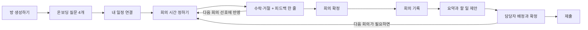

# 팀플 에이전트: 디자인 브리프 (공유용)

- 작성일: 2026-10-30 · 고친 날: 2026-11-03
- 형태: 폰 크기 웹앱

대학생 팀 프로젝트를 한 학기 동안 돕는 웹앱입니다. 팀원마다 붙는 AI 에이전트가 서로 양보하며 회의 시간을 잡고, 회의에서 정한 일을 할 일로 만들고, 마감까지 무엇이 막혔는지 먼저 알려 줍니다.

> **이 문서의 범위.** 각 화면에 **무엇이 들어가야 하는지**만 정합니다. 색, 글꼴, 배치, 컴포넌트 모양은 디자인 담당이 정합니다.
>
> **읽는 순서.** 화면을 쓰는 순서대로 묶었습니다. 1 → 2 → 3이 사람이 실제로 지나가는 길이고, 4는 그 위에서 계속 돌아가는 화면입니다.

---

## 11월 3일에 바뀐 것

이미 시안을 그렸다면 이 표부터 보고, 아래 11월 2일·1일 표를 차례로 보면 됩니다.

| 바뀐 것 | 지금 | 영향받는 화면 |
|---|---|---|
| **플랜 고르기 없앰** | 일정 플랜 추천이 사라집니다. 방 생성하기만 남습니다 | 방 생성하기, 일정 |
| **단계도 없앰** | 초안·검토 같은 단계를 쓰지 않습니다. 일정은 **마감까지 디데이**를 중심으로 보여 줍니다 | 일정, 홈 |
| **알림 5종 → 3종** | 단계가 없어져 "단계 지연"이, 2주 안에 넣기 버거워 "일 몰림"이 빠집니다. **늦음 / 막힘 / 완료** | 알림, 할 일 |
| **받아적기가 기본** | 회의 기록은 받아적기가 먼저 보이고 직접쓰기가 보조입니다. 전에는 반대로 적혀 있었습니다 | 회의 기록 |
| **진행률 숫자 없앰** | "진행 중 · 60%" 같은 숫자를 받지 않습니다. 시작 전 · 진행 중 · 막힘 · 완료 네 상태만 | 할 일 |
| **재분배 제안 없앰** | "현우의 OO를 지수가 받으면 고르게 됩니다" 같은 제안을 하지 않습니다. 팀 할 일에는 사람별 할 일 개수만 | 팀 할 일 |
| **원문 점프 없앰** | 요약 항목이나 할 일 제안에서 원문의 해당 발화로 뛰지 않습니다. 원문은 회의록에서 통째로 펼쳐 봅니다 | 회의록, 업무 배정 검토 |
| **점검일 없앰** | 중간 점검일을 받지도 보여 주지도 않습니다. **마감 디데이 하나로 관리합니다** | 방 생성하기, 일정 |
| **일정은 회의 관리 화면** | 마감 디데이 위에 **잡힌 회의 전부**가 놓입니다. 회의마다 응답 상태와 회의록으로 가는 길이 붙습니다. 조율 중인 회의도 자리를 잡아 둡니다 | 일정 |
| **진척 추적 없앰** | 진행률 숫자를 뺐으니 따로 추적하는 단계도 없습니다. 할 일 상태 네 개로 충분합니다 | 흐름도 |
| **예상 소요 시간 없앰** | 할 일에 몇 시간 걸릴지 적지 않습니다. 진척률과 일 몰림을 빼면서 이 숫자를 읽는 화면이 없어졌습니다 | 업무 배정 검토 |
| **하단 탭 4개** | 회의록 탭을 없애고 **회의에 관한 것을 전부 일정 아래**로 모았습니다. 홈 · 일정 · 할 일 · 나 | 탭 구조, 회의록, 업무 배정 검토 |
| **참석자 동의 없앰** | 받아적기 전에 동의를 받지 않습니다. 브라우저 마이크 권한만 최초 1회. 받아적는 중 표시는 그대로 둡니다 | 회의 기록 |
| **차선책 없앰** | 조율 결과에 차선책을 보여 주지 않습니다 | 회의 일정 조율 확인 |
| **온보딩 4문항** | 5문항에서 줄었습니다. 시간대는 아침·오전·점심·오후·저녁·밤 여섯 중 여러 개를 고를 수 있습니다 | 온보딩, 내 조건 |
| **에브리타임 공유 링크** | 시간표를 공유해서 나온 `everytime.kr/@아이디` 링크를 붙여 넣으면 수업이 그대로 들어옵니다. 사람이 확인할 필요가 없습니다 | 일정 연결 |
| **피하고 싶은 시간 다듬기** | 적은 말을 그대로 인용하지 않고 에이전트가 다듬어 이유로 말합니다 | 온보딩, 시간 정하는 과정 |
| **이번 주 사정 없앰** | 조율 시작에서 팀원이 한 줄 남기는 칸이 없습니다. 조율은 시간표·선호·누적 양보 점수만으로 돕니다 | 조율 시작 |

## 11월 2일에 바뀐 것

| 바뀐 것 | 지금 | 영향받는 화면 |
|---|---|---|
| **방 생성하기** | 화면 이름만 바뀌고 내용은 그대로입니다 | 방 생성하기, 홈 |
| **할 일 제안은 회의록에서 확정** | AI가 뽑은 할 일은 바로 등록하지 않고, **회의록에 "할 일 제안"으로 두었다가 확정해야** 할 일 탭에 들어갑니다 | 회의록(업무 배정 검토), 할 일 |
| **회의 일정 피드백** | 확정 뒤 따로 묻지 않고, 조율 결과에 **수락·거절을 누를 때** 한 줄을 함께 받습니다. 입력하지 않아도 됩니다 | 회의 일정 조율 확인 |
| **양보 점수 차등** | 이번에 받을 양보 점수는 맞춰 준 시간의 불편 정도에 따라 다릅니다(조금 불편 +1, 많이 불편 +2). 본인에게는 근거 한 줄을 붙입니다 | 회의 일정 조율 확인 |
| **알림 자리** | 알림 탭을 없애고 홈 오른쪽 위 종(안 읽은 수)으로 들어갑니다. "먼저 챙길 것"은 홈이 아니라 알림 화면 맨 위에 둡니다 | 홈, 알림, 탭 구조 |
| **"삭제" 문구** | 할 일을 지우는 버튼과 확인 창은 "삭제" 대신 **"필요 없음"** 으로 씁니다 | 할 일, 회의록 |
| **회의 자동 확정** | 확정 버튼을 없앴습니다. **전원이 수락하면 그 자리에서 자동으로 확정**되고 모두에게 알립니다 | 회의 일정 조율 확인 |
| **AI 멈춤 상태** | 따로 화면을 그리지 않습니다. 아래 "어디에나 지킬 것" 참고 | 회의록, 시간 정하는 과정 |

## 11월 1일에 바뀐 것

| 바뀐 것 | 지금 | 영향받는 화면 |
|---|---|---|
| **알림 카드 정리** | "줄줄이 밀림"(선행 관계를 알기 어려움), "임박", "담당자 없음"을 뺍니다. "멈춤"은 "막힘"으로 바꾸고 "완료"를 넣습니다 (11/3: 단계 지연과 일 몰림까지 빠져 3종) | 알림, 할 일 |
| **담당자 배정** | AI는 회의록에 담당자가 **확실하게 나온 경우에만** 채우고, 아니면 비워서 넘깁니다. 나머지는 사람이 붙입니다 | 업무 배정 검토, 팀 할 일 |
| **회의 일정 피드백** | 회의 시간에 대해 한 줄 남기면 다음 회의 선호에 반영됩니다. 회의가 끝난 뒤가 아니라 잡히자마자입니다 (11/2: 수락·거절할 때로 옮김) | 회의 일정 조율 확인 |
| **양보 점수** | 내가 이번에 받을 점수는 **숫자로** 보여 줍니다. 남의 것과 누적치는 여전히 단계로만 (11/2: 불편 정도에 따라 차등) | 회의 일정 조율 확인 |
| **온보딩** | 질문으로 선호를 먼저 받고, 그다음 일정 연결 (11/3: 4문항) | 화면 하나 새로 생김 |
| **마이크 권한** | 브라우저 권한은 **최초 1회만** (11/3: 참석자 동의는 받지 않음) | 회의 기록 |
| **회의 길이** | 제한 없음. 회의를 잡을 때 **30분 단위**로 정합니다 | 조율 시작 |

---

## 한눈에

**시연에서 기억에 남아야 할 장면은 두 가지입니다.** 이 두 장면에 나오는 화면을 가장 먼저, 가장 공들여 디자인해 주세요.

- **장면 1 — 에이전트끼리 양보하며 회의 시간 잡기.** 팀원별 에이전트가 각자의 사정을 말하고, 중립인 판단 에이전트가 정리해 회의안을 냅니다. 누가 맞춰 줬는지가 보여야 합니다. → 시간 정하는 과정, 회의 일정 조율 확인, 팀
- **장면 2 — 회의에서 할 일로, 그리고 마감까지.** 회의에서 나온 할 일과 알림이 마감까지의 일정 위에서 돌아갑니다. → 회의록, 업무 배정 검토, 할 일, 일정, 알림

### 전제

- 팀은 2~6명. 한국어만 씁니다.
- 회의는 주 1회쯤입니다. **한 번에 몇 시간 할지는 제한이 없고, 회의를 잡을 때 30분 단위로 정합니다.**
- **방 생성하기와 조율 시작은 팀장만** 합니다. 나머지는 모두가 씁니다. 그 밖의 권한은 담당자가 따로 정할 예정입니다.

---

## 1. 처음 들어올 때

### 온보딩 `[보조]` — 새로 생김

질문 네 개로 선호를 한 번에 받습니다. 답이 그대로 "내 조건" 화면의 값이 되므로 두 화면이 같은 항목을 써야 합니다.

1. 보통 몇 시부터 몇 시까지 가능해요?
2. 대면과 비대면 중 어느 쪽이 편해요?
3. 아침·오전·점심·오후·저녁·밤 중 언제가 좋아요? (여러 개 고를 수 있음)
4. 꼭 피하고 싶은 시간대가 있어요?

- **반드시**: 네 질문을 한 화면에, 건너뛰기
- **필수 항목은 없습니다.** 네 개를 다 비워도 다음으로 넘어갑니다.
- **참고**: 네 번째 답은 **그대로 인용하지 않고 에이전트가 다듬어서** 조율 때 이유로 말합니다. (예: "금요일 저녁은 피하고 싶어요" → "금요일 저녁은 개인 일정이 있어 어렵습니다") 한 줄로 쓰게 유도해 주세요.

### 일정 연결 `[보조]`

- **반드시**: 에브리타임 링크 · 구글 캘린더 · 직접 입력 세 갈래, "나중에 하기"
- **에브리타임 공유 링크**: 에브리타임에서 시간표를 공유하면 나오는 `everytime.kr/@아이디` 링크를 그대로 붙여 넣습니다. 수업 이름과 시각이 숫자로 들어오므로 **사람이 확인하는 단계가 필요 없습니다.** 링크가 안 읽히면 그 줄만 알려 주고 직접 입력으로 넘깁니다.
- **둘은 담는 게 다릅니다.** 에브리타임은 **수업**, 구글 캘린더는 **개인 약속**입니다. 둘 다 연결해야 시간표가 다 찹니다. 화면에서도 수업과 약속을 구분해서 보여 줍니다(약속은 제목 없이 "바쁨").
- **참고**: 두 갈래 옆에는 항상 직접 입력하는 길이 같이 있어야 합니다. 연결이 실패해도 진행이 막히지 않습니다.

### 방 생성하기 `[시연]` — 11/2에 "플랜 고르기"에서 이름이 바뀜

방을 만들면 초대 코드가 나옵니다.

- **입력**: 과제 제목(방 이름), 과제 설명 두세 줄, 기간(시작일·마감일), 평가 방식(발표·보고서·시연 등), 팀원 수
- **참고**: 결과 화면에 무엇이 들어가야 하는지는 **일부러 적지 않았습니다.** 여기까지 정해 두면 디자인에서 할 수 있는 게 좁아집니다. 입력만 받고 나머지는 디자인 담당이 정합니다.

---

## 2. 회의 잡기 (장면 1)

**흐름.** 팀장이 조율을 엽니다 → 에이전트가 라운드를 돕니다(최대 3) → 합의안이 팀원에게 갑니다. 이때 **내가 이번에 받을 양보 점수도 숫자로 함께** 보여 줍니다 → 수락·거절을 누를 때 그 시간에 대해 **피드백 한 줄**(비워도 됨) → 전원이 수락하면 바로 확정됩니다(따로 누르는 버튼 없음) → 회의 30분 전 알림

### 조율 시작 `[시연]`

팀장이 **주제**, **언제부터 언제 사이에**, **몇 시간짜리로 한 번** 할지를 지정합니다. 그러면 에이전트가 조율해서 시간을 잡습니다.

- **반드시**: 주제, 기간, 회의 길이(**30분 단위**), 방식(대면·비대면·상관없음)
- **참고**: 나머지 팀원은 알림으로 회의 일정 조율 확인에 바로 들어옵니다.

### 시간 정하는 과정 `[시연 · 핵심]`

왜 이 시간이 나왔는지 대화로 보여 줍니다. **이 앱에서 가장 중요한 화면입니다.**

- **반드시**: 누가 말하는지(팀원 에이전트와 판단 에이전트가 구분되게), 라운드 구분, 거절 이유
- **동작**: 발언이 하나씩 차례로 나타납니다(전체 30초 안팎). 끝나면 회의 일정 조율 확인으로 넘어갑니다.
- **상태**: 진행 중 · 3라운드 안에 합의 실패 → 후보 2~3개를 사람이 고르기 · 전원 가능한 시간 없음 → 1명 불참안
- **이 10~20초는 로딩이 아니라 구경거리입니다.** 스피너를 돌리면 시연에서 가장 중요한 장면을 덮습니다. 발언이 쌓이고 라운드 표시가 같이 올라가는 쪽으로 그려 주세요.

**내용 예시 (모양 아님)**

> — 1라운드 —
> **판단 에이전트**: 목요일 13:00–15:00을 제안합니다. 팀 전체로는 가장 덜 불편한 시간이에요.
> **지수의 에이전트**: 좋아요. 지수는 이 시간에 수업이 없어요.
> **현우의 에이전트**: 어렵습니다. 현우는 이 시간이 알바 끝나고 바로라 이동이 빠듯해요. 수요일 16시는 어떨까요?
> — 2라운드 —
> **판단 에이전트**: 현우는 지난 두 번의 회의에서 많이 맞춰 줬어요. 이번엔 현우 쪽을 먼저 챙겨 수요일 16:00–18:00으로 바꿉니다. 대신 민지가 조금 맞춰 주게 됩니다.
> **민지의 에이전트**: 수업 바로 뒤라 조금 빠듯하지만 괜찮아요.

### 회의 일정 조율 확인 `[시연]`

- **반드시**: 날짜, 시간, 방식, 내 불편 점수(숫자, 1~5)와 이유, 내가 이번에 받을 양보 점수(숫자), 다른 사람의 부담(괜찮음/조금/많이)과 이유, 양보 기록 때문에 누구를 배려했는지, 사람별 응답 상태, 수락·거절 버튼
- **차선책은 보여 주지 않습니다.** 고를 수 없는 안을 늘어놓지 않습니다.
- **동작**: 수락·거절할 때 한 줄을 남길 수 있고 비워도 됩니다(아래 회의 일정 피드백). **전원이 수락하면 그 자리에서 자동으로 확정되고 모두에게 알립니다**(확정 버튼·확인 창 없음). 그 전까지는 누가 아직 안 답했는지 이름으로 보여 줍니다.
- **양보 점수 차등**: 이번에 받을 양보 점수는 맞춰 준 시간의 불편 정도에 따라 다릅니다. 조금 불편(2~3점)은 +1, 많이 불편(4~5점)은 +2, 괜찮음(1점)은 받지 않습니다. 본인에게는 "내 불편 3/5만큼 맞춰 줘서 +1"처럼 근거 한 줄을 붙이고, 다른 사람에게는 "조금 불편한 시간을 맞춰 줬어요"처럼 말로만 보입니다.
- **참고**: 판단 에이전트가 쓴 설명은 1~3문장의 사람 말입니다. 내 점수 외에는 숫자가 나오지 않습니다.

### 회의 일정 피드백 — 조율 확인 화면 안에 있습니다

따로 화면을 두지 않습니다. 수락이나 거절을 누를 때 뜨는 확인 창에서 그 시간에 대해 한 줄을 함께 받습니다. 내 에이전트가 다음 회의부터 참고하고, 거절이면 판단 에이전트가 다음 라운드에도 반영합니다. 시간이 마음에 걸리면 응답하는 그 순간에 말하는 게 가장 정확하고, 한 번 더 묻지 않아도 됩니다.

- **반드시**: 수락·거절 확인 창 안의 한 줄 입력칸(비워도 됨), 응답 뒤 조율 확인 화면에 내가 남긴 말과 반영 결과
- **입력칸**: 한 줄짜리입니다. "너무 일렀어요", "금요일은 역시 힘드네요" 정도를 적게 유도하는 길이와 예시 문구를 둡니다. 긴 글을 받는 칸처럼 보이면 아무도 안 씁니다.
- **반영 결과**: 선호가 바뀌면 **무엇이 어떻게 바뀌었는지 한 줄로 보여 주고 되돌릴 수 있어야 합니다.** 예) "다음부터 11시 이전은 피할게요 · 되돌리기". 말없이 바꾸면 안 됩니다.
- **상태**: 아무것도 안 바뀜(적은 말이 시간과 상관없을 때) → 남겨 줘서 고맙다는 한 줄로 끝냅니다. 억지로 무언가 바꾸지 않습니다.
- **참고**: 필수가 아닙니다. 비워 두고 눌러도 바로 넘어갑니다.

---

## 3. 회의에서 할 일로 (장면 2)

**흐름.** 기록을 받습니다 → 요약됩니다 → 할 일이 회의록에 **"할 일 제안"** 으로 붙습니다 → 사람이 담당자를 붙이고 확정하면 할 일 탭에 들어갑니다.

### 회의 기록 `[시연]`

받아적는 중임을 숨기지 않습니다.

- **받아적기가 기본입니다.** 화면에 들어오면 받아적기 버튼이 먼저 보이고, 직접쓰기는 그 아래 작게 둡니다. 녹음해서 글로 남기는 게 이 화면의 본래 일입니다.
- **반드시**: 큰 받아적기 시작 버튼, **듣고 있다는 표시**("받아적는 중" 글자 또는 빨간 점 — 둘 중 하나는 늘 보여야 합니다), 경과 시간, "음성은 저장하지 않고 글자만 남깁니다" 안내, 정지, 받아적히는 글이 쌓이는 자리, 그 아래 직접쓰기로 가는 길
- **마이크 권한**: 브라우저 권한은 **최초 1회만** 묻습니다. 참석자 동의 단계는 없습니다. 대신 받아적는 동안 표시가 늘 보여서 숨기지 않습니다.
- **참고**: 직접쓰기는 받아적기가 안 될 때(마이크 없음, 조용히 해야 할 때, 인식 실패) 쓰는 보조 경로입니다. 말한 사람은 받아적는 사람이 고릅니다(자동 화자 구분 없음).

### 회의록 `[보조]`

- **반드시**: **주제 한 줄이 맨 위**, 그 아래 결정 / 논의 / 보류 구분, 참석자, 날짜별 목록, 원문 전체를 펼쳐 보는 자리
- **참고**: 요약 항목에서 원문의 해당 발화로 점프하지는 않습니다. 원문은 통째로 펼쳐 보는 것으로 충분합니다.
- **참고**: 날짜별 목록에서도 주제 한 줄이 보여야 나중에 찾을 수 있습니다. "11/5 회의"보다 "11/5 발표 자료 나누기"가 낫습니다.

### 업무 배정 검토 `[시연]` — 회의록 아래에 붙는 묶음입니다

담당자를 붙이고 확정하면 그때 할 일 탭에 들어갑니다. 확정 전 제안은 회의록에서만 보이고, 일정 탭에 확정 전 제안 수가 뜹니다.

- **담당자**: 회의록에 "이건 지수가"처럼 **확실하게 나온 것만 채워져 들어옵니다.** 나머지는 비어 있고 사람이 고릅니다. 비어 있는 칸이 많은 게 정상입니다.
- **반드시**: 이번 회의에서 나온 할 일 제안 목록, 담당자 고르기, "AI 제안" 표시, 항목마다 제목·기한 수정, 하나씩 버리기(한 번 더 확인), 하나씩·한꺼번에 확정(누가 확정했는지 남음)
- **한꺼번에 확정이 꼭 필요합니다.** 회의 하나에서 할 일이 여럿 나오는데 다 맞으면 여러 번 누를 이유가 없습니다.
- **상태**: 추출 중 · 뽑을 할 일을 못 찾음 → 직접 추가 안내

---

## 4. 굴러가는 동안

### 홈 `[시연]`
지금 무엇을 봐야 하는지 한 화면에서 보여 줍니다.
- **반드시**: 마감까지 남은 날(디데이), 다음 회의(또는 "조율 중"), 내 할 일, 오른쪽 위 알림 종(안 읽은 수)
- **상태**: 방 막 만든 직후 → 초대 코드와 들어온 인원 · 잡힌 회의 없음 → 회의 잡기 버튼
- **참고**: "먼저 챙길 것"(알림 카드)은 홈에 따로 두지 않고 알림 화면 맨 위에 둡니다. 홈에서는 종의 숫자와 내 할 일 옆 늦음·막힘 뱃지로 충분합니다.

### 일정 `[시연]`
**정해진 회의를 관리하는 화면입니다.** 마감까지 남은 기간 위에 회의들이 놓입니다. 단계도 점검일도 쓰지 않고 마감 디데이 하나로 관리합니다.

- **반드시**: 마감까지 남은 날(디데이), 마감일, 오늘 위치, **잡힌 회의 전부**
- **회의마다**: 날짜·시간, 방식(대면·비대면), 주제, 참석자 응답 상태(전원 수락이면 "확정"), 지난 회의면 회의록으로 가는 길
- **동작**: 새 회의 잡기(팀장), 아직 확정 안 된 회의의 조율 결과로 가기, 지난 회의의 회의록 열기
- **홈과 겹치지 않습니다.** 홈은 **다음 회의 하나**만 요약해 보여 주고, 여기서는 **지난 것까지 전부**를 시간 순으로 봅니다.
- **참고**: 조율 중인 회의도 자리를 잡아 둡니다("조율 중 · 11/10~11/14 사이"처럼). 언제 잡힐지 모르는 회의가 목록에서 사라져 있으면 안 됩니다.

### 팀 할 일 `[시연]`
- **반드시**: 확정된 할 일만(확정 전 제안이 있으면 "회의록에 제안 N개" 안내), 상태·담당자 필터, "담당자 없음" 묶음, 담당자 직접 지정·변경, "필요 없음"으로 빼기(한 번 더 확인), 늦음·막힘 뱃지, 사람별 할 일 개수
- **참고**: "담당자 없음" 묶음은 회의 직후에 가장 큽니다. **정상인 상태라 오류처럼 빨갛게 그리면 안 됩니다.**

### 내 할 일 `[시연]`
- **반드시**: 기한 순 목록(확정된 것만), 어느 회의에서 나왔는지(출처), 상태 바꾸기(시작 전 · 진행 중 · 막힘 · 완료)

### 알림 `[시연]`
홈 오른쪽 위 종으로 들어옵니다(하단 탭 없음). 맨 위가 "먼저 챙길 것"입니다.
- **반드시**: 알림 카드(종류 뱃지 + 이유 한 줄 + 해당 할 일로 이동), 회의 30분 전 카드, 회의 제안·확정 카드, 읽음 처리, 에이전트가 한 일 기록(무엇을, 왜)
- **30분 전 알림**: 회의 제목, 시작 시각, 방식, 이번에 다룰 것(지난 회의의 보류 항목, 남은 할 일 수). 웹 푸시와 알림함에 함께 들어갑니다.
- **상태**: 푸시 권한 요청, 권한 거부 시 "앱 안에서만 알려 드려요"

**알림 카드 3종과 뜨는 때.** 표의 순서가 정렬 순서입니다. 같은 카드는 상황이 바뀔 때만 다시 뜨므로 알림함이 같은 카드로 가득 차지 않습니다. 앞의 둘은 챙기라는 알림이고 "완료"만 좋은 소식이라, 뱃지가 둘을 구분해야 합니다.

| 카드 | 언제 |
|---|---|
| 늦음 | 기한이 지났는데 끝나지 않았습니다 |
| 막힘 | 담당자가 막혔다고 표시했습니다 |
| 완료 | 할 일이 완료로 바뀌었습니다 |

### 내 조건 `[보조]`
- **반드시**: 주간 시간표(수업 / 알바 / 캘린더 약속 / 확정된 회의 구분, 약속은 제목 없이 "바쁨"), 연동 상태와 마지막 동기화 시각, 선호 조건(온보딩 답 네 개와 같은 항목), 프라이버시 안내

### 팀 `[시연]`
- **반드시**: 팀원 목록과 초대, 역할, 사람별 양보 점수 누적(단계 표시), 회의별로 누가 왜 맞춰 줬는지 기록

---

## 어디에나 지킬 것

- **내부 숫자는 보이지 않습니다. 단, 내 점수는 예외입니다.** 불편은 1~5점으로 계산합니다. **내 불편 점수와 내가 이번에 받을 양보 점수는 본인에게만 숫자로 보입니다**(예: "내 불편 4/5 · 수업 바로 뒤"). 다른 사람의 점수, 가중치, 누적 양보 점수는 숫자 없이 "많이 / 조금 / 괜찮음" 같은 말이나 단계 표시로만 보입니다.
- **색만으로 상태를 구분하지 않습니다.** 모든 상태에 글자 뱃지를 함께 붙입니다.
- **에이전트가 한 일은 항상 "왜"와 함께 보여 줍니다.** 알림과 회의안에 모두 이유 한 줄이 붙습니다.
- **되돌릴 수 없는 동작은 한 번 더 묻습니다.** 할 일 빼기(필요 없음), 할 일 제안 버리기, 요약 발송. 할 일을 지우는 버튼은 "삭제" 대신 **"필요 없음"** 이라고 씁니다. 회의 확정은 전원 수락으로 자동이라 묻지 않습니다.
- **받아적는 중임을 숨기지 않습니다.** 동의 단계는 없지만, 받아적는 동안 표시가 늘 보이고 녹음은 하지 않고 텍스트만 남긴다는 점을 화면에서 분명히 알립니다.
- **AI가 뽑은 할 일은 확정해야 할 일이 됩니다.** 확정 전에는 회의록에 "AI 제안" 표시와 함께 "할 일 제안"으로만 있고, 할 일 탭과 내 할 일에는 보이지 않습니다. 확정하면 표시가 사라지고 할 일 탭에 들어갑니다. 제안은 버릴 수 있고, 확정된 할 일을 "필요 없음"으로 빼는 것은 누구나 할 수 있습니다.
- **담당자는 확실할 때만 AI가 채웁니다.** 회의록에 분명히 나온 경우가 아니면 비워 둡니다. 그래서 "담당자 없음"은 고쳐야 할 오류가 아니라 **정상적인 시작 상태**입니다.
- **담당자를 붙이는 것과 확정하는 것은 다릅니다.** 회의록의 제안에 담당자만 정해 두고 확정은 나중에 할 수 있습니다. 뱃지가 이 둘을 구분해야 합니다.
- **연동은 모두 선택입니다.** 에브리타임 링크를 붙여 넣지 않아도, 구글 캘린더를 연결하지 않아도 모든 화면이 직접 입력으로 동작해야 합니다. 연결 버튼 옆에는 항상 직접 입력하는 길이 있어야 합니다.
- **AI 멈춤은 따로 화면을 그리지 않습니다.** 시연에서는 서버·AI가 실패해도 준비된 데이터로 그대로 이어 가므로 사용자에게 보일 일이 없습니다. 실제로 멈추면 "잠시 후 다시 해 주세요" 한 줄과 다시 하기 버튼이면 충분합니다. 직접 쓰기, 할 일 직접 추가, 일정 직접 입력처럼 AI가 필요 없는 길은 그대로 됩니다.

### 기다림과 빈 화면

**기다림이 있는 화면은 네 개뿐입니다.** 나머지는 서버가 계산만 하므로 바로 나옵니다. 즉시 나오는 화면에 스켈레톤을 넣으면 없던 기다림을 만드는 셈입니다.

| 기다리는 곳 | 얼마나 | 그동안 무엇을 보여 주나 |
|---|---|---|
| 시간 정하는 과정 | 10~20초 | 발화가 한 줄씩 쌓인다. 빈 화면을 보여 주지 않는다 |
| 받아적기 | 회의 내내 | "받아적는 중" 표시와 지금까지 받아적힌 글 |
| 회의록 정리 | 20초까지 | 원문을 먼저 보이고 요약 자리만 비워 둔다 |
| 할 일 뽑기 | 20초까지 | 끝나면 목록이 한 번에 들어온다 |

**빈 화면에는 항상 다음 행동 버튼이 있어야 합니다.** 아무것도 없다는 말만 써 놓은 화면은 만들지 않습니다.

| 빈 화면 | 보여 줄 것 |
|---|---|
| 할 일이 없다 | 회의가 있으면 회의록으로, 없으면 회의 잡기 버튼 |
| 회의록이 없다 | 회의 기록으로 가는 버튼 |
| 뽑힌 할 일이 없다 | 직접 추가 버튼 |
| 알림이 없다 | 좋은 상태라고 쓴다. 빈 상자로 두지 않는다 |
| 일정 연결을 안 했다 | 링크 붙여넣기와 직접 입력 버튼. 연동은 선택이라 막히면 안 된다 |

### 같은 말 쓰기

화면 전체에서 같은 단어를 씁니다. 모양은 자유지만 단계 수와 이름은 지켜 주세요.

| 대상 | 단계 | 쓰이는 곳 |
|---|---|---|
| 회의 시간의 불편 정도 (다른 사람) | 괜찮음 / 조금 / 많이 (1점 = 괜찮음, 2~3점 = 조금, 4~5점 = 많이) | 시간 정하는 과정, 회의 일정 조율 확인 |
| 회의 시간의 불편 점수 (나) | "내 불편 4/5" + 이유 | 회의 일정 조율 확인, 내 조건 |
| 할 일 확정 여부 | AI 제안 / 확정 | 회의록의 할 일 제안 |
| 할 일 지우기 | 필요 없음 ("삭제"라고 쓰지 않음) | 할 일, 회의록 |
| 담당자 | 담당자 없음 / 이름 | 모든 할 일 목록, 업무 배정 검토 |
| 양보 점수 (이번에 받을 것, 내 것) | 숫자 + 근거 한 줄. 조금 불편 +1, 많이 불편 +2 | 회의 일정 조율 확인 |
| 양보 점수 (누적) | 숫자 대신 단계. 예) "아직 없음 → 조금 맞춰 줌 → 많이 맞춰 줌" | 회의 일정 조율 확인, 팀 |
| 할 일 상태 | 시작 전 / 진행 중 / 막힘 / 완료 | 팀 할 일, 내 할 일 |
| 할 일 출처 | 11/5 회의 / 직접 추가 | 할 일 목록 |
| 알림 카드 3종 | 늦음 / 막힘 / 완료 | 알림, 할 일 |
| 회의안 응답 | 대기 / 수락 / 거절 | 회의 일정 조율 확인 |
| 회의록 요약 분류 | 결정 / 논의 / 보류 | 회의록 |

### 반복해서 나오는 요소

| 요소 | 들어가는 것 | 나오는 화면 |
|---|---|---|
| 에이전트 말풍선 | 말한 에이전트(팀원 이름 또는 판단 에이전트), 내용. 둘을 구분 | 시간 정하는 과정 |
| 라운드 구분 | 몇 번째 라운드인지, 최대 3 | 시간 정하는 과정 |
| 사람별 부담 줄 | 이름, 불편 단계(본인 줄만 1~5 숫자), 이유 한 줄 | 회의 일정 조율 확인 |
| 양보 점수 표시 | 누적은 단계로(숫자 없음), 내가 이번에 받을 것만 숫자 | 회의 일정 조율 확인, 팀 |
| 할 일 행 | 제목, 담당자(또는 "담당자 없음"), 기한, 상태 뱃지, 출처, 늦음·막힘 뱃지, 필요 없음 | 팀 할 일, 내 할 일, 홈 |
| 제안 카드 | "AI 제안" 표시, 담당자 칸(대개 비어 있음), 고칠 수 있는 칸, 버리기, 확정 | 업무 배정 검토(회의록) |
| 알림 카드 | 종류 뱃지, 이유 한 줄, 관련 할 일, 이동 버튼 | 알림 |
| 듣고 있다는 표시 | "받아적는 중" 글자 또는 빨간 점, 경과 시간. 받아적는 동안 늘 보임 | 회의 기록 |
| 다시 묻기 창 | 무엇을 하는지, 되돌릴 수 없다는 안내, 확인·취소. 수락·거절 창에는 한 줄 입력칸 | 할 일 필요 없음, 제안 버리기, 발송, 수락·거절 |
| 디데이 | 마감까지 남은 날 | 홈, 일정 |

### 탭 구조

하단 탭은 **네 개**입니다. 알림은 탭이 아니라 홈 오른쪽 위 종으로 들어갑니다.

| 탭 | 그 아래 열리는 화면 |
|---|---|
| 홈 | 조율 시작, 시간 정하는 과정, 회의 일정 조율 확인, 알림(종) |
| 일정 | 잡힌 회의 관리, 회의 기록, 회의록, 업무 배정 검토 |
| 할 일 | 팀 할 일, 내 할 일 |
| 나 | 내 조건, 팀 |

**회의에 관한 것은 전부 일정 아래로 모았습니다.** 회의는 일정에 잡히고, 그 회의를 누르면 기록·회의록·할 일 제안이 거기 달려 있습니다. 회의록만 따로 탭을 두면 "이 회의의 회의록"을 찾으러 두 탭을 오가게 됩니다.

방 생성하기(팀장 1회)와 온보딩(1회)은 탭 밖의 처음 화면입니다. 회의 일정 피드백은 수락·거절 창 안에 있습니다.

**시연용 장치 두 가지**도 눈에 띄지 않는 곳에 들어가야 합니다 — 사용자 바꾸기(팀원 사이를 바로 바꿔 봄), 시연용 시계("오늘"을 앞으로 옮겨 늦음 알림과 30분 전 알림을 띄움).

---

## 시안에 쓸 예시 데이터

개발 쪽 시드 데이터와 맞추면 시연 화면과 시안이 일치합니다.

- **지수**: 팀장 · 자료조사
- **민지**: 발표 · 수업이 많음
- **현우**: 개발 · 평일 저녁 알바, 지난 회의에서 두 번 맞춰 줌
- **서연**: 디자인 · 비대면 선호

프로젝트는 서비스디자인 팀 프로젝트, 평가는 최종 발표 + 시연, 마감 2026-12-11입니다.

---

## 정해진 것

- **시연 환경(11/1).** 노트북 한 대에서 한 화면에 휴대폰 화면 2개(서로 다른 팀원)와 시연 장치를 함께 띄웁니다. 한쪽에서 수락하면 다른 쪽에 바로 반영돼야 합니다.

## 아직 안 정해진 것

- **권한 영역.** 누가 무엇을 할 수 있는지는 담당자가 정할 예정입니다.
- **탭 아래 화면 배치.** 위의 탭 구조는 제안입니다.
- **누적 양보 점수의 단계 표현.** 단계 수와 모양은 디자인 담당이 정해 주세요. 누적치는 숫자만 피하면 됩니다(내가 이번에 받을 점수는 숫자로 보여 줍니다).
